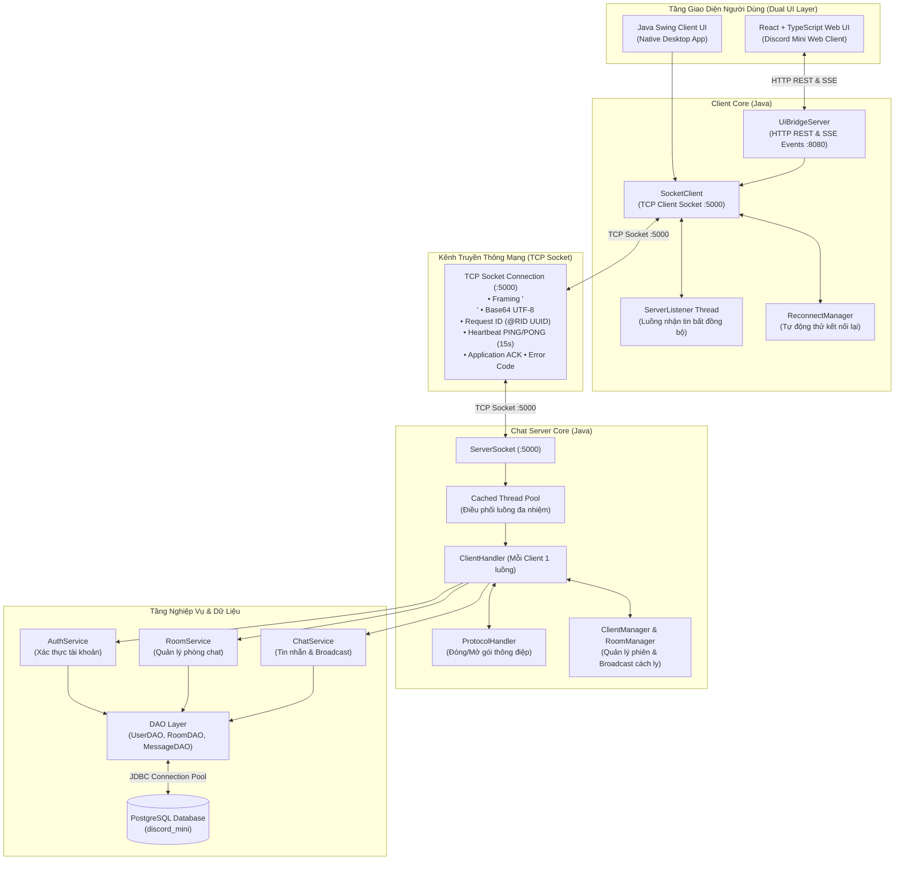
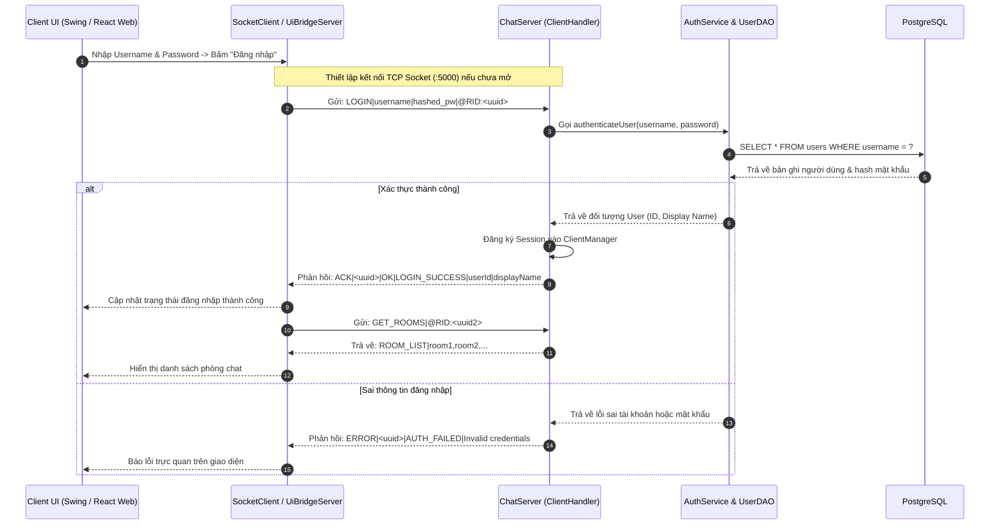
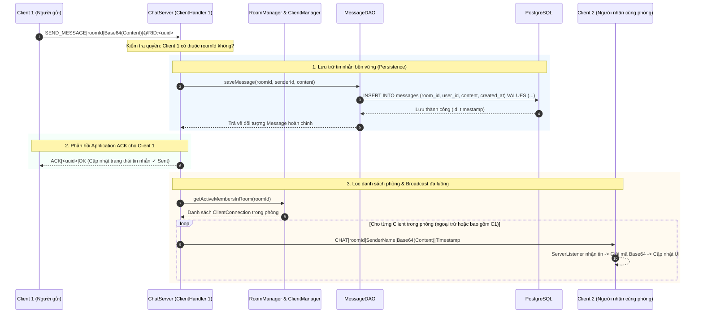
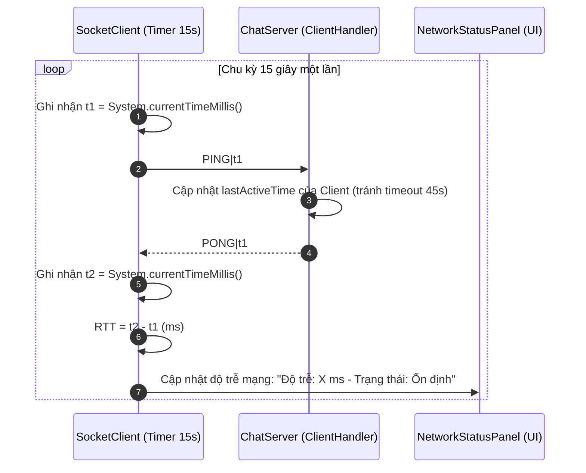
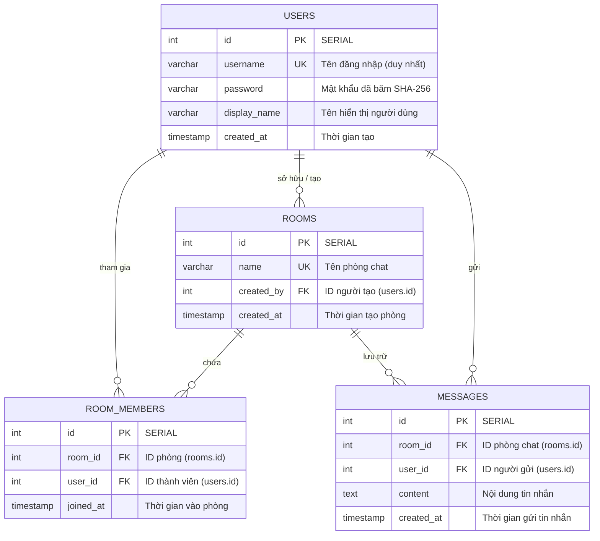

# Discord Mini — Ứng dụng Chat Nhóm Java TCP Socket & Web Client

Ứng dụng chat nhóm theo mô hình **Client–Server**, xây dựng bằng **Java TCP Socket**, hỗ trợ giao diện đa nền tảng gồm **Java Swing (Native GUI)** và **Discord Mini Web Client (React + TypeScript + Vite)** qua tầng cầu nối **UiBridgeServer**. Dự án phục vụ đồ án môn **Lập trình mạng máy tính (CMP180)**, tập trung vào lập trình mạng tầng Socket, xử lý đa luồng đồng thời (Multithreading), quản lý phiên kết nối, thiết kế giao thức mạng tin cậy (Reliable Custom Protocol), và lưu trữ dữ liệu bền vững bằng **PostgreSQL**.

---

## 1. Mục tiêu dự án

- **Kiến trúc Client–Server hướng chuẩn mạng:** Xây dựng hệ thống chat nhóm theo kiến trúc Client–Server sử dụng TCP Socket tại cổng `:5000`.
- **Giao thức ứng dụng tin cậy (Reliable Custom Protocol):** Tự thiết kế và cài đặt tầng giao thức trên nền TCP với cơ chế Request ID (`@RID` UUID), đóng gói Framing phân tách dòng (`\n`), mã hóa Base64 UTF-8, Application ACK (`ACK|id|OK`), Heartbeat PING/PONG (chu kỳ 15s) đo độ trễ RTT (Round Trip Time ms) và quản lý Timeout toàn diện.
- **Xử lý đa luồng đồng thời (Concurrency & Multithreading):** Server sử dụng Thread Pool (`Executors.newCachedThreadPool`), đảm bảo phục vụ đồng thời hàng chục Client kết nối mà không xung đột tài nguyên nhờ đồng bộ hóa luồng an toàn (`ConcurrentHashMap`, `synchronized`).
- **Giao diện người dùng kép (Dual Client UI):**
  - **Native Client:** Giao diện Java Swing truyền thống (`MainFrame`, `RoomPanel`, `MessagePanel`, `NetworkStatusPanel`) với mô hình đa luồng nền (`SwingWorker`, `ServerListener`) không làm đơ/chặn Event Dispatch Thread (EDT).
  - **Modern Web Client:** Giao diện người dùng phong cách Discord hiện đại viết bằng **React 19 + TypeScript + Vite + Tailwind/Discord CSS**, kết nối thông qua tầng cầu nối HTTP REST & Server-Sent Events (SSE) của `UiBridgeServer`.
- **Quản lý dữ liệu & Lưu trữ tin nhắn bền vững:** Quản lý tài khoản, danh sách phòng, thành viên và lịch sử tin nhắn bền vững trên **PostgreSQL 15+** qua **JDBC Connection Pool** và mô hình Data Access Object (DAO).
- **Chuẩn hóa quy trình phát triển:** Tuân thủ 100% quy trình làm việc chuyên nghiệp trên Git/GitHub: Protected Branches, Issue Task Board, Conventional Commits, Peer Review PR/MR và bảng ma trận đóng góp minh bạch.

---

## 2. Công nghệ sử dụng

| Tầng / Thành phần | Công nghệ & Thư viện | Vai trò trong hệ thống |
|---|---|---|
| **Ngôn ngữ lõi** | Java (JDK 21+) | Phát triển Server lõi, Client Socket và các dịch vụ mạng |
| **Giao tiếp mạng lõi** | TCP Socket (`java.net.Socket`, `ServerSocket`) | Kênh truyền thông tin cậy full-duplex giữa Client và Server |
| **Giao diện Native** | Java Swing / AWT | Giao diện máy tính để bàn chuẩn cho đồ án mạng |
| **Giao diện Hiện đại** | React 19, TypeScript, Vite, Tailwind/Discord CSS | Giao diện web mô phỏng Discord Mini trực quan, mượt mà |
| **Cầu nối giao diện (Bridge)**| `UiBridgeServer` (`com.sun.net.httpserver`) | Cầu nối HTTP REST & SSE realtime giữa Web Client và TCP Socket Client |
| **Cơ sở dữ liệu** | PostgreSQL 15+ | Lưu trữ quan hệ người dùng, phòng chat, thành viên và tin nhắn |
| **Kết nối CSDL** | JDBC (`postgresql-42.7.3.jar`), Connection Pool | Truy vấn an toàn qua `PreparedStatement`, chống SQL Injection |
| **Quản lý phiên & Đa luồng** | `CachedThreadPool`, `ConcurrentHashMap`, Atomic | Điều phối kết nối, đồng bộ phiên và broadcast tin nhắn theo phòng |
| **Quản lý mã nguồn** | Git, GitHub | Quản lý phiên bản, phân nhánh tính năng, Review chéo Pull Request |
| **Kiểm thử tự động** | JUnit, Integration Tests, Stress Tests | Kiểm thử hồi quy giao thức, kiểm thử chịu tải đồng thời |

### Môi trường phát triển đề xuất

- **JDK:** OpenJDK 21 trở lên.
- **Node.js:** Node 20 LTS trở lên (dành cho phần Web Frontend).
- **PostgreSQL:** PostgreSQL 15 hoặc mới hơn (chạy cổng `5432`).
- **JDBC Driver:** `postgresql-42.7.3.jar` (tự động tải bằng script `Chatserver/lib/download_driver.bat` hoặc PowerShell).
- **IDE đề xuất:** NetBeans 19+, IntelliJ IDEA, hoặc VS Code.

> **Lưu ý vệ sinh mã nguồn:** Kho mã nguồn tuân thủ nghiêm ngặt quy chế **không commit file `.jar` và không commit file cấu hình chứa mật khẩu thật (`db.properties`)** vào Git. Vui lòng chạy script tải driver và tạo file `db.properties` từ file mẫu `db.properties.example` trước khi chạy.

---

## 3. Kiến trúc hệ thống

Hệ thống hoạt động theo mô hình **Client–Server phân tầng**, hỗ trợ đồng thời hai kênh trải nghiệm người dùng (Native Swing và Web React) qua cùng một tầng lõi mạng TCP Socket đồng nhất:



### Trách nhiệm các thành phần

| Thành phần | Trách nhiệm kỹ thuật chi tiết |
|---|---|
| **Swing Client UI** | Hiển thị giao diện Native: Đăng ký/Đăng nhập, danh sách phòng, cửa sổ chat, bảng giám sát mạng (RTT ms). |
| **React Web UI** | Giao diện hiện đại phong cách Discord: Kênh phòng chat, danh sách thành viên online, tin nhắn realtime, biểu tượng cảm xúc. |
| **UiBridgeServer** | Máy chủ HTTP nhúng (`com.sun.net.httpserver`) bên trong Client, mở API REST và kênh SSE đẩy sự kiện realtime từ Socket lên giao diện Web. |
| **SocketClient** | Quản lý kết nối TCP Socket đầu cuối, cơ chế tự động gửi Heartbeat PING định kỳ và xử lý Application ACK. |
| **ServerListener** | Luồng Worker chạy ngầm chuyên lắng nghe dữ liệu từ Server gửi về, đẩy sang Event Dispatch Thread hoặc Bridge không gây lag UI. |
| **ChatServer & ServerSocket** | Mở cổng TCP `:5000`, tiếp nhận kết nối mới và chuyển giao sang Thread Pool. |
| **ClientHandler** | Quản lý chu kỳ sống của một kết nối Client cụ thể, giải mã thông điệp và điều phối dịch vụ. |
| **ProtocolHandler** | Chuẩn hóa cấu trúc gói tin, mã hóa/giải mã payload Base64 UTF-8, đính kèm Request ID `@RID` và kiểm soát cú pháp. |
| **ClientManager & RoomManager** | Quản lý danh sách người dùng online (`ConcurrentHashMap`), phòng chat đang mở và thực hiện broadcast cách ly phòng (Room Isolation). |
| **Data Access Layer (DAOs)** | Tương tác trực tiếp với cơ sở dữ liệu PostgreSQL qua các câu lệnh SQL an toàn (`PreparedStatement`). |

---

## 4. Giao thức truyền thông (Application Protocol)

Hệ thống sử dụng **Giao thức ứng dụng dạng bản rõ có phân tách dòng (Line-based Text Protocol)** được tối ưu hóa độ tin cậy trên nền TCP:

- **Framing (Phân khung):** Mỗi gói tin kết thúc bằng ký tự xuống dòng `\n`.
- **Mã hóa Payload:** Nội dung văn bản người dùng nhập được mã hóa **Base64 UTF-8** để bảo toàn dữ liệu chứa ký tự đặc biệt, dấu xuống dòng hoặc ký tự phân tách.
- **Request ID (`@RID`):** Mỗi gói tin yêu cầu từ Client đều mang một mã nhận diện duy nhất dạng UUID (ví dụ `@RID:123e4567-e89b-12d3-a456-426614174000`) nhằm hỗ trợ đối soát phản hồi và tính toán RTT.
- **Application ACK:** Server phản hồi xác nhận nhận gói tin `ACK|<request_id>|OK` ngay sau khi xử lý hoặc lưu trữ thành công.
- **Heartbeat PING/PONG:** Client chủ động gửi gói `PING` định kỳ mỗi 15 giây; Server phản hồi `PONG` kèm timestamp. Độ trễ giữa hai gói tin là căn cứ đo Round Trip Time (RTT).

### Danh mục thông điệp cốt lõi

| Lệnh giao thức | Chiều truyền | Cấu trúc minh họa | Ý nghĩa |
|---|:---:|---|---|
| `REGISTER` | Client → Server | `REGISTER\|<username>\|<password>\|<display_name>` | Đăng ký tài khoản người dùng mới |
| `LOGIN` | Client → Server | `LOGIN\|<username>\|<password>` | Xác thực đăng nhập vào hệ thống |
| `LOGOUT` | Client → Server | `LOGOUT\|<username>` | Thông báo đăng xuất và đóng phiên làm việc |
| `CREATE_ROOM` | Client → Server | `CREATE_ROOM\|<room_name>` | Tạo một phòng chat mới |
| `JOIN_ROOM` | Client → Server | `JOIN_ROOM\|<room_id>` | Tham gia vào một phòng chat cụ thể |
| `LEAVE_ROOM` | Client → Server | `LEAVE_ROOM\|<room_id>` | Rời khỏi phòng chat hiện tại |
| `SEND_MESSAGE` | Client → Server | `SEND_MESSAGE\|<room_id>\|<base64_content>` | Gửi tin nhắn vào phòng chat |
| `GET_ROOMS` | Client → Server | `GET_ROOMS` | Lấy danh sách toàn bộ các phòng chat |
| `GET_MESSAGES`| Client → Server | `GET_MESSAGES\|<room_id>` | Tải lịch sử tin nhắn của phòng chat |
| `CHAT` | Server → Client | `CHAT\|<room_id>\|<sender>\|<base64_content>\|<time>` | Phát tán (Broadcast) tin nhắn đến các thành viên trong phòng |
| `ACK` | Hai chiều | `ACK\|<request_id>\|OK` | Xác nhận đã xử lý hoàn tất yêu cầu |
| `ERROR` | Server → Client | `ERROR\|<request_id>\|<error_code>\|<message>` | Thông báo mã lỗi chuẩn (`AUTH_FAILED`, `ROOM_NOT_FOUND`,...) |
| `PING` / `PONG`| Hai chiều | `PING\|<timestamp>` / `PONG\|<timestamp>` | Giữ kết nối (Keep-Alive) & đo độ trễ RTT mạng |

> Đặc tả giao thức chi tiết được lưu trữ đầy đủ tại: [`docs/PROTOCOL.md`](docs/PROTOCOL.md).

---

## 5. Luồng hoạt động hệ thống (Sequence Diagrams)

### 5.1. Luồng Kết nối, Xác thực Đăng nhập & Đăng ký

Hệ thống hỗ trợ Client đăng nhập trực tiếp (qua Swing GUI) hoặc thông qua Web Bridge:



---

### 5.2. Luồng Gửi Tin Nhắn Phòng, Lưu Trữ Bền Vững & Broadcast Realtime

Tuân thủ nguyên tắc **Message Persistence**: Tin nhắn bắt buộc phải được ghi nhận an toàn vào cơ sở dữ liệu PostgreSQL trước khi Server phản hồi `ACK` cho người gửi và phát tán (`Broadcast`) đến các thành viên trong phòng:



---

### 5.3. Luồng Heartbeat Keep-Alive & Giám Sát Độ Trễ Mạng (RTT Monitor)



---

## 6. Cơ sở dữ liệu (Database Schema)

Dự án sử dụng cơ sở dữ liệu **PostgreSQL** (tên mặc định: `discord_mini`). Kịch bản khởi tạo chuẩn được lưu tại [`schema.sql`](schema.sql) và [`Chatserver/sql/schema.sql`](Chatserver/sql/schema.sql).

### Sơ đồ thực thể quan hệ (ERD)



### Cấu hình kết nối CSDL

Dự án tuyệt đối không commit file mật khẩu lên Git. Cấu hình được nạp từ `db.properties` theo thứ tự ưu tiên:
1. File cấu hình cục bộ `Chatserver/src/com/discordmini/server/config/db.properties` hoặc `Chatserver/src/config/db.properties`.
2. Biến môi trường hệ thống (`DB_URL`, `DB_USER`, `DB_PASSWORD`).
3. Cấu hình mặc định dự phòng (`localhost:5432/discord_mini`, user: `postgres`).

Để cấu hình, nhóm cung cấp file mẫu [`Chatserver/db.properties.example`](Chatserver/db.properties.example):
```properties
db.url=jdbc:postgresql://localhost:5432/discord_mini
db.user=postgres
db.password=YOUR_ACTUAL_PASSWORD_HERE
db.driver=org.postgresql.Driver
db.pool.max_connections=20
```

---

## 7. Cấu trúc thư mục dự án

```text
DA_LapTrinhMangMayTinh/
├── .github/                                # Template chuẩn Issue và Pull Request
│   ├── ISSUE_TEMPLATE/task_issue.md
│   └── pull_request_template.md
├── .gitignore                              # Bộ lọc tệp rác chuẩn 7 ràng buộc Git
├── README.md                               # Tài liệu hướng dẫn & Bảng ma trận đóng góp
├── schema.sql                              # Kịch bản khởi tạo CSDL PostgreSQL gốc
│
├── ChatClient/                             # Project NetBeans Client (Java Swing + Core Socket)
│   ├── build.xml
│   ├── manifest.mf
│   ├── nbproject/                          # Cấu hình project NetBeans
│   ├── src/com/discordmini/client/
│   │   ├── ClientApplication.java          # Điểm khởi chạy Java Swing Client
│   │   ├── bridge/
│   │   │   └── UiBridgeServer.java         # Cầu nối HTTP REST & SSE cho Web React
│   │   ├── model/                          # Các thực thể dữ liệu (ChatMessage, Room, User,...)
│   │   ├── network/                        # Quản lý Socket, Reconnect, Listener đa luồng
│   │   ├── protocol/                       # Mã hóa/giải mã giao thức, Request, Response
│   │   ├── service/                        # AuthService, ChatService, RoomService
│   │   └── ui/                             # Giao diện Swing (MainFrame, Login, Room, Monitor)
│   └── test/                               # Bộ kiểm thử đơn vị & kiểm thử kết nối tự động
│
├── Chatserver/                             # Project NetBeans Server (Java ServerSocket & DB)
│   ├── build.xml
│   ├── db.properties.example               # Mẫu cấu hình bảo mật không lộ mật khẩu
│   ├── lib/
│   │   ├── README.md                       # Hướng dẫn tải thư viện JDBC Driver
│   │   ├── download_driver.bat             # Script tự động tải driver PostgreSQL cho Windows
│   │   └── download_driver.ps1             # Script PowerShell tải driver
│   ├── nbproject/
│   ├── sql/
│   │   └── schema.sql                      # Schema CSDL PostgreSQL đồng bộ cho Server
│   ├── src/com/discordmini/server/
│   │   ├── ServerApplication.java          # Điểm khởi chạy Chat Server
│   │   ├── config/DatabaseConnection.java  # Quản lý kết nối JDBC Connection Pool
│   │   ├── dao/                            # Tầng truy xuất dữ liệu (UserDAO, RoomDAO, MessageDAO)
│   │   ├── manager/                        # ClientManager (Session) & RoomManager
│   │   ├── network/                        # ChatServer, ClientConnection, ClientHandler
│   │   ├── protocol/                       # Xử lý giao thức phía Server & Error codes
│   │   └── service/                        # Nghiệp vụ Chat, Room, Auth, Persistence
│   └── test/                               # Kiểm thử chịu tải đa luồng & kiểm thử giao thức
│
├── frontend/                               # Ứng dụng Web Discord Mini (React + TypeScript + Vite)
│   ├── index.html
│   ├── package.json
│   ├── tsconfig.json
│   ├── vite.config.ts
│   └── src/
│       ├── App.tsx                         # Khung ứng dụng chính
│       ├── components/                     # Workspace, RoomSidebar, ChatCenter, MemberSidebar
│       ├── services/chatBridge.ts          # Kết nối tới UiBridgeServer qua HTTP / SSE
│       └── styles/discord.css              # Giao diện phong cách Discord hiện đại
│
└── docs/                                   # Tài liệu đặc tả kỹ thuật chi tiết
    ├── PROTOCOL.md                         # Tài liệu đặc tả Giao thức truyền thông
    └── VI_WORKLOG.md                       # Nhật ký phân tích và công việc kỹ thuật
```

---

## 8. Hướng dẫn cài đặt và vận hành

### Bước 1: Khởi tạo Cơ sở dữ liệu PostgreSQL

1. Mở công cụ quản trị (pgAdmin 4 hoặc `psql`).
2. Tạo database mới:
   ```sql
   CREATE DATABASE discord_mini;
   ```
3. Chạy kịch bản khởi tạo bảng từ [`schema.sql`](schema.sql):
   ```bash
   psql -U postgres -d discord_mini -f schema.sql
   ```
4. Thiết lập cấu hình: Tạo file `Chatserver/src/com/discordmini/server/config/db.properties` từ file mẫu [`Chatserver/db.properties.example`](Chatserver/db.properties.example) và điền mật khẩu PostgreSQL của máy bạn.

---

### Bước 2: Tải JDBC Driver cho PostgreSQL

Kho lưu trữ không lưu file nhị phân `.jar`. Chạy script tải tự động (chỉ cần chạy một lần):
```powershell
# Chạy script tải driver cho Windows
.\Chatserver\lib\download_driver.bat
```
Script sẽ tự động tải file `postgresql-42.7.3.jar` vào thư mục `Chatserver/lib/`.

---

### Bước 3: Khởi chạy Chat Server

- **Bằng IDE (NetBeans / IntelliJ IDEA):** Mở project `Chatserver`, chạy lớp chính [`com.discordmini.server.ServerApplication`](Chatserver/src/com/discordmini/server/ServerApplication.java).
- Server sẽ lắng nghe kết nối TCP tại cổng `:5000`:
  ```text
  [SERVER] Máy chủ Discord Mini khởi động thành công trên cổng 5000.
  [DB] Đã kết nối cơ sở dữ liệu PostgreSQL an toàn qua JDBC Pool.
  ```

---

### Bước 4: Khởi chạy Client

#### Cách 1: Khởi chạy Native Java Swing Client (Khuyến nghị cho kiểm thử chấm điểm)
- Mở project `ChatClient` trên IDE.
- Chạy lớp chính [`com.discordmini.client.ClientApplication`](ChatClient/src/com/discordmini/client/ClientApplication.java).
- Mở cùng lúc 2 hoặc nhiều cửa sổ Client để kiểm thử tính năng chat thời gian thực giữa nhiều người dùng trong các phòng khác nhau.

#### Cách 2: Khởi chạy Web Client phong cách Discord (Tùy chọn nâng cao)
1. Trong Java Client, chạy `ClientApplication` (hoặc khởi động `UiBridgeServer` ở cổng `:8080`).
2. Mở terminal tại thư mục `frontend`:
   ```bash
   cd frontend
   npm install
   npm run dev
   ```
3. Truy cập trình duyệt tại `http://localhost:5173` để trải nghiệm giao diện Discord Mini hiện đại.

---

## 9. Bảng ma trận đóng góp thành viên (README Contribution Matrix)

> **Tuân thủ Mục 6 - TÀI LIỆU HƯỚNG DẪN QUY TRÌNH VÀ RÀNG BUỘC THỰC HIỆN DỰ ÁN TRÊN GIT/GITHUB:**
> Bảng thống kê minh bạch sự phân công, công việc cụ thể và các Merge Request (Pull Request) đã được nghiệm thu của từng thành viên trong nhóm làm căn cứ đối chiếu khi giảng viên chấm điểm bảo vệ cuối kỳ.

### 9.1. Bảng ma trận đóng góp chuẩn 4 cột bắt buộc

| MSSV | Họ và Tên | Công việc đã thực hiện | Merge Requests |
|:---:|---|---|:---:|
| **2380602519** | **Bùi Hà Yến Vi** *(Trưởng nhóm)* | • Thiết kế chuẩn hóa bộ giao thức ứng dụng Custom Protocol (`MessageType`, `Request`, `Response`).<br>• Cài đặt đóng gói Framing dòng (`\n`), mã hóa Base64 UTF-8 an toàn dữ liệu, Request ID (`@RID` UUID), Sequence Number.<br>• Xử lý Application ACK (`ACK\|id\|OK`), tối ưu cờ socket `TCP_NODELAY`.<br>• Cài đặt Heartbeat PING/PONG (chu kỳ 15s) & Quản lý cơ chế Timeout đa tầng.<br>• Định nghĩa bảng mã lỗi chuẩn `ProtocolErrorCode`, viết đặc tả `docs/PROTOCOL.md`.<br>• Tích hợp toàn hệ thống Client - Server - Database, giải quyết xung đột mã nguồn và chuẩn hóa quy trình Git/GitHub. | [!6](https://github.com/BuiHaYenVi/DA_LapTrinhMangMayTinh/pull/6)<br>[!7](https://github.com/BuiHaYenVi/DA_LapTrinhMangMayTinh/pull/7)<br>[!10](https://github.com/BuiHaYenVi/DA_LapTrinhMangMayTinh/pull/10)<br>[!20](https://github.com/BuiHaYenVi/DA_LapTrinhMangMayTinh/pull/20)<br>[!21](https://github.com/BuiHaYenVi/DA_LapTrinhMangMayTinh/pull/21)<br>[!23](https://github.com/BuiHaYenVi/DA_LapTrinhMangMayTinh/pull/23) |
| **2380600023** | **Tống Nhật Bảo An** | • Xây dựng lõi kết nối TCP Socket Client & Quản lý vòng đời trạng thái kết nối (`ConnectionManager`).<br>• Tách luồng nhận tin bất đồng bộ `ServerListener` (tránh nghẽn Swing Event Dispatch Thread).<br>• Cài đặt cơ chế tự động kết nối lại (Auto-reconnection) với số lần thử giới hạn.<br>• Xây dựng giao diện Swing Native (`MainFrame`, `RoomPanel`, `MessagePanel`, `LoginFrame`, `RegisterFrame`).<br>• Thiết kế bảng Network Status Monitor hiển thị trạng thái kết nối và đo độ trễ RTT (ms).<br>• Phát triển tầng cầu nối `UiBridgeServer` (HTTP/SSE) kết nối giao diện Web React với Socket Client. | [!9](https://github.com/BuiHaYenVi/DA_LapTrinhMangMayTinh/pull/9)<br>[!11](https://github.com/BuiHaYenVi/DA_LapTrinhMangMayTinh/pull/11)<br>[!12](https://github.com/BuiHaYenVi/DA_LapTrinhMangMayTinh/pull/12) |
| **2380602574** | **Vũ Anh Vinh** | • Khởi tạo và quản lý `ServerSocket.accept()` đón nhận kết nối Client tại cổng TCP `:5000`.<br>• Xây dựng kiến trúc xử lý đa luồng đồng thời bằng Thread Pool (`Executors.newCachedThreadPool`).<br>• Quản lý phiên và đồng bộ dữ liệu an toàn luồng (`ConcurrentHashMap`, `synchronized`).<br>• Cài đặt cơ chế phân tách phòng (Room Isolation) & Broadcast tin nhắn theo phòng.<br>• Thực hiện kiểm thử chịu tải (Stress Test) mô phỏng nhiều client kết nối đồng thời. | [!2](https://github.com/BuiHaYenVi/DA_LapTrinhMangMayTinh/pull/2)<br>[!4](https://github.com/BuiHaYenVi/DA_LapTrinhMangMayTinh/pull/4) |
| **2380600575** | **Nguyễn Thanh Hải** | • Thiết kế cơ sở dữ liệu quan hệ PostgreSQL (`schema.sql`).<br>• Cài đặt tầng kết nối JDBC Connection Pool (`DatabaseConnection.java`) an toàn.<br>• Xây dựng đầy đủ các lớp truy xuất dữ liệu: `UserDAO`, `RoomDAO`, `MessageDAO`.<br>• Cài đặt cơ chế lưu trữ tin nhắn bền vững (Message Persistence - lưu DB thành công mới phát tin).<br>• Cài đặt chức năng truy xuất lịch sử chat khi người dùng tham gia phòng (`Join Room`).<br>• Xử lý ngoại lệ CSDL (`SQLException`) và chuyển đổi thành mã lỗi giao thức chuẩn. | [!5](https://github.com/BuiHaYenVi/DA_LapTrinhMangMayTinh/pull/5) |

---

### 9.2. Bảng ma trận nghiệm thu & Review chéo (Peer Review Matrix)

> **Tuân thủ nghiêm ngặt Quy định 5:** Mỗi Pull Request (MR) bắt buộc phải có ít nhất 1 thành viên khác trong nhóm kiểm tra mã nguồn, chạy thử nghiệm kiểm chứng và nhấn **Approve**. Nghiêm cấm tuyệt đối hành vi tự tạo PR và tự Approve cho chính mình.

| Mã PR | Nhánh tính năng (Feature Branch) | Tác giả (Author) | Thành viên Review chéo (Peer Reviewer) | Nội dung nghiệm thu & Bằng chứng kiểm thử |
|:---:|---|:---:|:---:|---|
| [**#2**](https://github.com/BuiHaYenVi/DA_LapTrinhMangMayTinh/pull/2) | `feature/2380602574-issue-1-chat-client-server` | **Vũ Anh Vinh** | **Tống Nhật Bảo An** | Kiểm tra kết nối TCP Socket `:5000`, Client gửi và nhận gói tin chào mừng ban đầu ổn định; đính kèm ảnh chụp màn hình kiểm thử. |
| [**#4**](https://github.com/BuiHaYenVi/DA_LapTrinhMangMayTinh/pull/4) | `feature/2380602574-issue-4-client-handler-manager` | **Vũ Anh Vinh** | **Nguyễn Thanh Hải** | Kiểm tra quản lý phiên `ClientManager` đa luồng, kiểm tra giải phóng tài nguyên khi Client ngắt kết nối đột ngột; đính kèm console log. |
| [**#5**](https://github.com/BuiHaYenVi/DA_LapTrinhMangMayTinh/pull/5) | `feature/2380600575-issue-8-database-connection` | **Nguyễn Thanh Hải** | **Vũ Anh Vinh** | Kiểm tra kết nối PostgreSQL, khởi tạo bảng theo schema, thực thi an toàn qua `PreparedStatement`; đính kèm ảnh truy vấn pgAdmin. |
| [**#6**](https://github.com/BuiHaYenVi/DA_LapTrinhMangMayTinh/pull/6) | `feature/2380602519-issue-2-server-db-integration` | **Bùi Hà Yến Vi** | **Nguyễn Thanh Hải** | Tích hợp Server Core đa luồng với tầng CSDL PostgreSQL; kiểm tra luồng xác thực đăng nhập người dùng từ DB. |
| [**#7**](https://github.com/BuiHaYenVi/DA_LapTrinhMangMayTinh/pull/7) | `feature/2380602519-issue-3-protocol-reliability` | **Bùi Hà Yến Vi** | **Tống Nhật Bảo An** | Kiểm tra cơ chế Request ID `@RID`, phản hồi `ACK|id|OK`, chu kỳ Heartbeat `PING`/`PONG` 15s; đính kèm kết quả đo độ trễ RTT. |
| [**#9**](https://github.com/BuiHaYenVi/DA_LapTrinhMangMayTinh/pull/9) | `feature/2380600023-issue-7-auth-ui` | **Tống Nhật Bảo An** | **Bùi Hà Yến Vi** | Kiểm tra giao diện Swing Đăng nhập và Đăng ký; kiểm tra ràng buộc dữ liệu đầu vào và hiển thị lỗi xác thực từ Server. |
| [**#10**](https://github.com/BuiHaYenVi/DA_LapTrinhMangMayTinh/pull/10) | `feature/2380602519-issue-5-group-chat-completion` | **Bùi Hà Yến Vi** | **Vũ Anh Vinh** | Kiểm tra Server broadcast tin nhắn đồng thời tới nhiều client trong cùng phòng chat; đính kèm ảnh 2 client chat song song. |
| [**#11**](https://github.com/BuiHaYenVi/DA_LapTrinhMangMayTinh/pull/11) | `feature/2380600023-issue-10-network-monitor` | **Tống Nhật Bảo An** | **Bùi Hà Yến Vi** | Kiểm tra bảng giám sát trạng thái mạng `NetworkStatusPanel`, hiển thị RTT ms thời gian thực từ gói tin PING/PONG. |
| [**#12**](https://github.com/BuiHaYenVi/DA_LapTrinhMangMayTinh/pull/12) | `feature/2380600023-issue-9-chat-ui` | **Tống Nhật Bảo An** | **Nguyễn Thanh Hải** | Kiểm tra giao diện chính Swing MainFrame, danh sách phòng, tin nhắn, và cơ chế tự động kết nối lại khi mất mạng. |
| [**#20**](https://github.com/BuiHaYenVi/DA_LapTrinhMangMayTinh/pull/20) | `feature/2380602519-issue-3-protocol-reliability` | **Bùi Hà Yến Vi** | **Nguyễn Thanh Hải** | Chạy toàn bộ bộ kiểm thử hồi quy `ProtocolHandlerTest` và `SocketClientReliabilityTest` (PASS 100%), đối soát tài liệu giao thức. |
| [**#21**](https://github.com/BuiHaYenVi/DA_LapTrinhMangMayTinh/pull/21) | `feature/2380602519-issue-11-repo-hygiene` | **Bùi Hà Yến Vi** | **Vũ Anh Vinh** | Kiểm toán toàn diện vệ sinh repo, cập nhật `.gitignore` chuẩn hóa, loại bỏ các file nháp và mật khẩu CSDL. |
| [**#23**](https://github.com/BuiHaYenVi/DA_LapTrinhMangMayTinh/pull/23) | `feature/2380602519-issue-6-team-integration` | **Bùi Hà Yến Vi** | **Tống Nhật Bảo An** | Tích hợp toàn hệ thống (Swing Client + Server Core + PostgreSQL + Web Bridge), giải quyết xung đột trước khi gộp vào `main`. |

---

## 10. Quy trình và Ràng buộc thực hiện dự án trên Git/GitHub

Tất cả thành viên trong nhóm bắt buộc phải tuân thủ nghiêm ngặt **7 quy định kỹ thuật và chế tài kỷ luật** theo hướng dẫn của giảng viên:

### 1. Thiết Lập Định Danh Cá Nhân (Bắt Buộc)
Mỗi sinh viên bắt buộc cấu hình định danh cá nhân trên Git tại máy cục bộ (local machine) khớp chính xác với danh sách lớp. Hệ thống từ chối ghi nhận điểm đối với tài khoản ẩn danh, tài khoản ảo hoặc thông tin không rõ ràng.
```bash
git config --global user.name "MSSV_HoVaTen"
git config --global user.email "email_sinh_vien@domain"
```
- **Ràng buộc nghiêm ngặt:** Tuyệt đối không sử dụng máy hoặc tài khoản của sinh viên khác để commit thay. Mọi dấu hiệu commit hộ (một người push mã nguồn cho cả nhóm) sẽ dẫn đến việc hủy kết quả của những thành viên không có lịch sử làm việc trên hệ thống.

### 2. Quản Lý Công Việc Bằng Issue (Task Board)
Mọi đầu việc từ nhỏ đến lớn (thiết kế CSDL, viết giao thức, làm giao diện, fix bug) đều phải được khởi tạo thành Issue trên GitHub trước khi bắt tay vào viết code.
- **Phân rõ trách nhiệm:** Mỗi Issue chỉ gán (Assign) cho **ĐÚNG 1 NGƯỜI** chịu trách nhiệm chính.
- **Gắn nhãn (Label) và Cột mốc (Milestone):** Issue bắt buộc gắn nhãn (vd: `network`, `ui`, `database`, `protocol`, `bug`, `enhancement`) và thuộc về một Milestone cụ thể (vd: `Tuần 1`, `Tuần 2`,...).

### 3. Chiến Lược Phân Nhánh (Branching Strategy)
Nhánh chính (`main` / `master` / `develop`) được nhóm trưởng và giảng viên khóa bảo vệ (**Protected Branches**). Mọi thao tác push mã nguồn trực tiếp lên nhánh chính đều bị hệ thống từ chối.
- **Quy tắc rẽ nhánh:** Khi bắt đầu giải quyết một Issue, sinh viên bắt buộc tạo nhánh cá nhân mới từ nhánh chính.
- **Cú pháp đặt tên nhánh:**
  ```text
  feature/<MSSV>-issue-<Số_Issue>-<Tên_ngắn_gọn>
  ```
  *Ví dụ:* `feature/2380602519-issue-3-protocol-reliability`, `feature/2380600023-issue-9-chat-ui`.

### 4. Tiêu Chuẩn Commit Mã Nguồn
Lịch sử commit là cơ sở để chấm điểm chuyên cần và đánh giá quá trình phát triển phần mềm.
- **Tuân thủ Conventional Commits:** `<loại>: <mô tả ngắn gọn>`
  - Các loại được chấp nhận: `feat` (tính năng mới), `fix` (sửa lỗi), `refactor` (tối ưu code), `docs` (tài liệu), `test` (kiểm thử).
  - *Ví dụ:* `feat: thêm cơ chế heartbeat ping pong`, `fix: lỗi rò rỉ kết nối socket khi đóng client`.
- **Vệ sinh mã nguồn (Cực kỳ quan trọng):**
  - Bắt buộc duy trì file `.gitignore` đúng chuẩn ngôn ngữ và công nghệ sử dụng.
  - Nghiêm cấm commit các thư mục build (`target/`, `node_modules/`, `bin/`, `build/`, `dist/`), cấu hình cá nhân (`.idea/`, `.vscode/`, `nbproject/private/`), file cấu hình chứa mật khẩu thật (`db.properties`), hoặc file nhị phân lớn (`*.jar`, `*.zip`).

### 5. Quy Trình Tích Hợp (Merge Request / Pull Request)
Khi tính năng đã hoàn thiện trên nhánh cá nhân, sinh viên mở Pull Request (PR) để yêu cầu gộp code vào nhánh chính.
- **Mô tả chi tiết:** Mô tả PR phải nêu rõ: Đã làm gì? Có ảnh hưởng đến module khác không? Đính kèm ảnh chụp màn hình chứng minh code đã chạy và vượt qua kiểm thử thành công.
- **Review chéo (Peer Review):** Bắt buộc phải có **ÍT NHẤT 1 THÀNH VIÊN KHÁC** trong nhóm vào kiểm tra code, để lại nhận xét và bấm nút **Approve**.
- **Nghiêm cấm hành vi tự tạo PR và tự Approve cho chính mình.**

### 6. Cập Nhật Bảng Đóng Góp (README.md)
Tại thư mục gốc của kho lưu trữ, nhóm duy trì file `README.md` có bảng ma trận thống kê sự đóng góp của các thành viên (Mục 9) với 4 cột bắt buộc: `MSSV`, `Họ và Tên`, `Công việc đã thực hiện`, `Merge Requests` để đối chiếu khi chấm điểm bảo vệ cuối kỳ.

### 7. Chế Tài Xử Lý Vi Phạm
- **Vi phạm vệ sinh kho mã nguồn:** Push file rác, file build, file nhị phân lớn, hoặc file lộ thông tin mật khẩu -> **Trừ 20% tổng điểm nhóm**.
- **Phát hiện "Big Bang Commit":** Push dồn cục một lượng lớn mã nguồn vào 1-2 ngày trước hạn nộp mà không có lịch sử làm việc liên tục -> **Hủy kết quả điểm đánh giá quá trình chuyên cần**.
- **Gian lận đóng góp:** Khi vấn đáp cuối kỳ, nếu sinh viên không giải thích được luồng logic của đoạn code do chính tài khoản mình commit -> **Hủy toàn bộ điểm đề tài của cá nhân đó**.