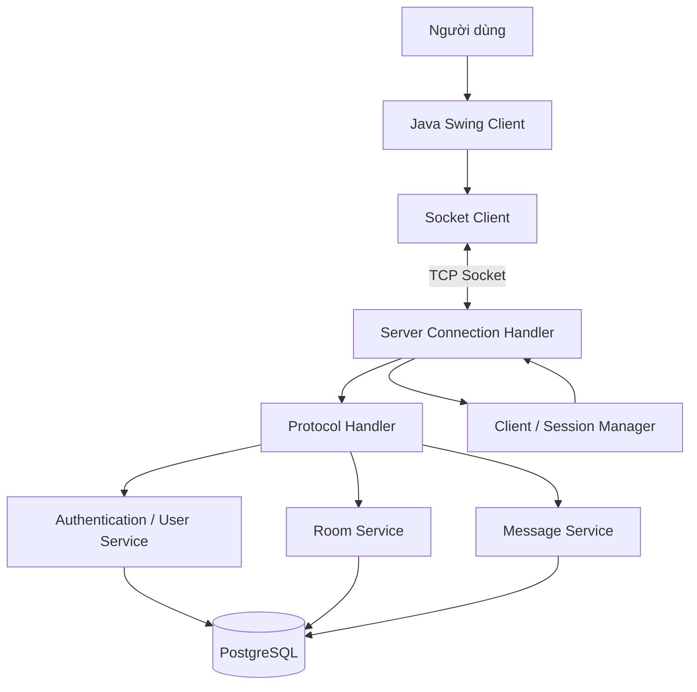
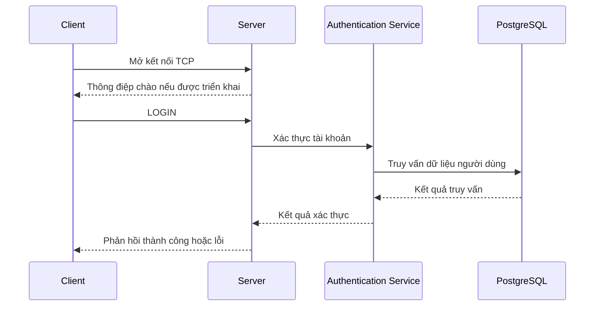
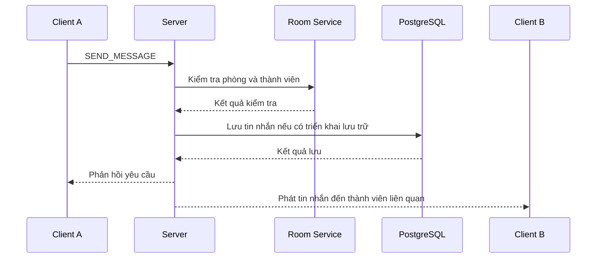

# Discord Mini — Ứng dụng Chat Nhóm Java TCP Socket

Ứng dụng chat nhóm theo mô hình **Client–Server**, xây dựng bằng Java TCP Socket và Java Swing. Dự án phục vụ đồ án môn **Lập trình mạng máy tính (CMP180)**, tập trung vào lập trình mạng, xử lý đồng thời, quản lý phiên người dùng, giao thức ứng dụng và lưu trữ dữ liệu bằng PostgreSQL.

## 1. Mục tiêu dự án

- Xây dựng ứng dụng chat nhóm theo kiến trúc Client–Server.
- Cho phép người dùng đăng ký, đăng nhập, quản lý phòng chat và trao đổi tin nhắn.
- Xử lý nhiều kết nối TCP đồng thời.
- Quản lý trạng thái kết nối và phiên người dùng.
- Lưu trữ dữ liệu bằng PostgreSQL.
- Tổ chức mã nguồn theo các lớp trách nhiệm rõ ràng, thuận tiện cho kiểm thử và phát triển tiếp.

## 2. Công nghệ sử dụng

| Thành phần | Công nghệ |
|---|---|
| Ngôn ngữ | Java |
| Giao tiếp mạng | TCP Socket |
| Giao diện | Java Swing |
| Cơ sở dữ liệu | PostgreSQL |
| Kết nối CSDL | JDBC |
| Môi trường phát triển | IntelliJ IDEA hoặc IDE hỗ trợ Java |
| Quản lý mã nguồn | Git, GitHub |
| Kiểm thử | Các bài kiểm thử theo module và kiểm thử tích hợp |

### Môi trường đề xuất

- JDK 21 trở lên.
- PostgreSQL 15 trở lên.
- JDBC Driver: `postgresql-42.7.3.jar` (tự động tải bằng script `Chatserver/lib/download_driver.bat` hoặc PowerShell).
- Git để lấy mã nguồn.

> Lưu ý: Nhóm tuân thủ quy chế không commit file `.jar` vào Git; vui lòng chạy script tải driver trước khi mở project trên IDE.

## 3. Kiến trúc hệ thống

Ứng dụng sử dụng mô hình Client–Server. Client chịu trách nhiệm giao diện và gửi yêu cầu; Server tiếp nhận kết nối, xử lý yêu cầu, quản lý phiên và phối hợp với lớp dữ liệu.



### Các thành phần chính

| Thành phần | Trách nhiệm |
|---|---|
| Client UI | Hiển thị giao diện đăng nhập, danh sách phòng và tin nhắn |
| Socket Client | Quản lý kết nối TCP, gửi và nhận dữ liệu |
| Server Application | Khởi tạo và vận hành máy chủ |
| Client Handler | Xử lý yêu cầu từ một kết nối client |
| Protocol Handler | Phân tích thông điệp theo giao thức ứng dụng |
| Client Manager | Theo dõi kết nối và phiên người dùng |
| User Service | Xử lý nghiệp vụ người dùng |
| Room Service | Xử lý nghiệp vụ phòng chat |
| Message Service | Xử lý tin nhắn |
| Data Access Layer | Truy cập và cập nhật dữ liệu PostgreSQL |

Tên lớp và trách nhiệm chi tiết có thể khác tùy theo phiên bản mã nguồn hiện tại.

## 4. Giao thức truyền thông

Client và Server trao đổi thông điệp dạng văn bản qua TCP Socket. Mỗi thông điệp được biểu diễn theo một cấu trúc quy ước; các trường phải được phân tích nhất quán ở cả hai phía.

Một số thông điệp nghiệp vụ thường gặp:

| Thông điệp | Mục đích |
|---|---|
| `REGISTER` | Đăng ký tài khoản |
| `LOGIN` | Đăng nhập |
| `LOGOUT` | Đăng xuất |
| `CREATE_ROOM` | Tạo phòng chat |
| `JOIN_ROOM` | Tham gia phòng |
| `LEAVE_ROOM` | Rời phòng |
| `SEND_MESSAGE` | Gửi tin nhắn |
| `GET_ROOMS` | Lấy danh sách phòng |
| `GET_MESSAGES` | Lấy lịch sử tin nhắn |
| `PING` / `PONG` | Kiểm tra kết nối, nếu được hỗ trợ |
| `ACK` | Xác nhận xử lý yêu cầu, nếu được hỗ trợ |
| `ERROR` | Thông báo lỗi |

### Quy ước giao thức

- Client và Server phải thống nhất tên lệnh, thứ tự trường và cách mã hóa dữ liệu.
- Nếu dữ liệu được Base64 mã hóa, hai phía phải dùng cùng một quy ước mã hóa.
- Nếu sử dụng `request_id`, mã yêu cầu cần được liên kết đúng với phản hồi tương ứng.
- Nếu có `ACK` và `ERROR` mở rộng, định dạng thực tế phải khớp với mã nguồn và tài liệu giao thức.
- Không nên tự ý đổi định dạng thông điệp ở một phía mà không cập nhật phía còn lại.

Chi tiết định dạng chính thức cần được duy trì tại [`docs/PROTOCOL.md`](docs/PROTOCOL.md) nếu tệp này có trong repository.

## 5. Luồng hoạt động

### 5.1. Kết nối và đăng nhập



### 5.2. Gửi tin nhắn trong phòng



Thứ tự lưu dữ liệu và phát tin nhắn cần được kiểm tra theo implementation thực tế. Không nên coi sơ đồ trên là bằng chứng rằng mọi phiên bản đã triển khai đầy đủ cơ chế lưu trước khi phát.

## 6. Cơ sở dữ liệu

PostgreSQL là cơ sở dữ liệu chính của phiên bản hiện tại.

Các nhóm dữ liệu nghiệp vụ thường bao gồm:

| Nhóm dữ liệu | Mục đích |
|---|---|
| Users | Thông tin tài khoản |
| Rooms | Thông tin phòng chat |
| Room Members | Quan hệ giữa người dùng và phòng |
| Messages | Nội dung tin nhắn và thông tin liên quan |

Tên bảng, cột, khóa ngoại và chỉ mục phải theo đúng tệp SQL hoặc cấu trúc cơ sở dữ liệu thực tế của dự án.

### Cấu hình kết nối

Có thể sử dụng các biến cấu hình tương tự sau nếu ứng dụng hỗ trợ:

```properties
DB_URL=jdbc:postgresql://localhost:5432/discord_mini
DB_USER=postgres
DB_PASSWORD=<your_database_password>
```

Không đưa mật khẩu cơ sở dữ liệu thật vào Git. Có thể cung cấp tệp mẫu như `db.properties.example` và hướng dẫn người chạy tạo cấu hình riêng.

### Lịch sử lưu trữ

Nếu phiên bản MVP trước đây từng lưu dữ liệu trong các tệp `.txt`, hãy xem đó là cơ chế lưu trữ của phiên bản cũ. Hướng dẫn chạy hiện tại cần ưu tiên PostgreSQL, tránh hướng dẫn người dùng cấu hình đồng thời hai cơ chế lưu trữ nếu chương trình không hỗ trợ điều đó.

## 7. Cấu trúc thư mục

Cấu trúc tổng quát của repository:

```text
LTMang/
├── ChatClient/
│   └── src/
├── Chatserver/
│   └── src/
├── docs/
│   ├── PROTOCOL.md
│   └── VI_WORKLOG.md
├── README.md
└── .gitignore
```

Đây là cấu trúc minh họa. Khi cập nhật README trong repository, cần đối chiếu tên thư mục và tệp thực tế; không tạo các thư mục tài liệu hoặc mã nguồn chỉ để khớp với sơ đồ.

## 8. Cài đặt và chạy ứng dụng

### Bước 1. Lấy mã nguồn

```bash
git clone https://github.com/BuiHaYenVi/DA_LapTrinhMangMayTinh.git
cd DA_LapTrinhMangMayTinh
```

Nếu đã có mã nguồn trên máy, chuyển đến thư mục repository hiện tại thay vì clone lại.

### Bước 2. Chuẩn bị PostgreSQL

1. Cài đặt và khởi động PostgreSQL.
2. Tạo database có tên phù hợp với cấu hình của dự án, ví dụ `discord_mini`.
3. Khởi tạo các bảng bằng tệp SQL chính thức của repository.
4. Kiểm tra tên database, tài khoản, mật khẩu và cổng kết nối.
5. Cấu hình JDBC Driver nếu chưa được tích hợp trong project.

Không sử dụng tệp backup hoặc dữ liệu cá nhân làm tệp khởi tạo mặc định. Chỉ chạy tệp SQL sau khi đã xác định đúng mục đích và nội dung của nó.

### Bước 3. Cấu hình kết nối

Thiết lập cấu hình theo cơ chế mà mã nguồn hiện tại sử dụng, chẳng hạn biến môi trường hoặc tệp properties. Bảo đảm thông tin kết nối không bị commit lên Git.

### Bước 4. Biên dịch và chạy Server

Mở project `Chatserver` bằng IDE, kiểm tra JDK và các thư viện cần thiết, sau đó chạy lớp khởi động server.

Nếu tên lớp chính của phiên bản hiện tại là `com.discordmini.server.ServerApplication`, hãy chọn lớp đó làm Main Class. Nếu mã nguồn thực tế dùng tên khác, ưu tiên tên trong project.

Server phải khởi động thành công trước khi client kết nối. Nếu server sử dụng cổng mặc định `5000`, hãy bảo đảm cổng này chưa bị chương trình khác chiếm dụng.

### Bước 5. Chạy Client

Mở project `ChatClient`, kiểm tra cấu hình địa chỉ server và cổng TCP, sau đó chạy lớp khởi động client.

Nếu lớp chính là `com.discordmini.client.ClientApplication`, hãy chạy lớp này. Kiểm tra địa chỉ server và cổng trong cấu hình; client và server phải sử dụng cùng một cổng.

### Bước 6. Kiểm tra chức năng

1. Mở server.
2. Khởi chạy ít nhất hai client.
3. Đăng ký hoặc đăng nhập bằng các tài khoản thử nghiệm.
4. Kiểm tra danh sách phòng và thao tác tham gia phòng.
5. Gửi tin nhắn từ client thứ nhất và kiểm tra client còn lại.
6. Kiểm tra lịch sử tin nhắn nếu chức năng này được triển khai.
7. Đóng client và kiểm tra server có xử lý ngắt kết nối phù hợp.

## 9. Kiểm thử

Các bài kiểm thử nên bao phủ nhiều lớp:

| Nhóm kiểm thử | Nội dung |
|---|---|
| Unit Test | Kiểm tra các lớp nghiệp vụ độc lập |
| Protocol Test | Kiểm tra phân tích thông điệp và phản hồi |
| Authentication Test | Kiểm tra đăng nhập, đăng ký và dữ liệu đầu vào không hợp lệ |
| Room Test | Kiểm tra tạo phòng, tham gia và rời phòng |
| Messaging Test | Kiểm tra gửi và nhận tin nhắn |
| Concurrency Test | Kiểm tra nhiều client hoạt động đồng thời |
| Disconnect Test | Kiểm tra ngắt kết nối và dọn dẹp phiên |
| Integration Test | Kiểm tra phối hợp Client, Server và PostgreSQL |

### Nguyên tắc báo cáo kết quả

- Chỉ ghi `PASS` khi bài kiểm thử đã thực sự được chạy và đạt kết quả mong đợi.
- Ghi rõ các bài kiểm thử chưa chạy hoặc còn phụ thuộc môi trường.
- Tách biệt lỗi môi trường, lỗi cấu hình và lỗi logic.
- Sau khi sửa giao thức, cần kiểm tra cả Client lẫn Server để phát hiện sai lệch định dạng thông điệp.

## 10. Xử lý sự cố thường gặp

### Không kết nối được Server

- Kiểm tra server đã khởi động chưa.
- Kiểm tra địa chỉ IP và cổng TCP.
- Kiểm tra tường lửa và cổng có bị chiếm dụng không.
- Kiểm tra client và server có dùng cùng cấu hình không.

### Không kết nối được PostgreSQL

- Kiểm tra dịch vụ PostgreSQL.
- Kiểm tra database đã được tạo.
- Kiểm tra URL JDBC, tên người dùng và mật khẩu.
- Kiểm tra JDBC Driver và log lỗi kết nối.

### Client và Server không hiểu thông điệp của nhau

- Đối chiếu tên lệnh và thứ tự trường.
- Kiểm tra cách mã hóa và giải mã dữ liệu.
- Kiểm tra ký tự phân tách trường.
- Đối chiếu phiên bản giao thức giữa hai project.
- Kiểm tra định dạng `ACK` và `ERROR` nếu phiên bản hiện tại hỗ trợ.

### Không đăng nhập được

- Kiểm tra tài khoản thử nghiệm và dữ liệu trong PostgreSQL.
- Kiểm tra logic xác thực và thông báo lỗi.
- Kiểm tra cách lưu và xác minh mật khẩu theo implementation hiện tại.
- Không ghi mật khẩu thật vào log hoặc repository.

## 11. Giới hạn hiện tại

Các giới hạn cần được đánh giá dựa trên phiên bản mã nguồn và kết quả kiểm thử, có thể bao gồm:

- Giao tiếp TCP chưa được mã hóa bằng TLS.
- Chất lượng xử lý lỗi phụ thuộc vào từng nhánh xử lý yêu cầu.
- Cần kiểm tra thêm các tình huống nhiều client thao tác đồng thời.
- Khả năng phục hồi kết nối và gửi lại yêu cầu phụ thuộc vào cơ chế giao thức được triển khai.
- Khả năng mở rộng còn phụ thuộc vào thiết kế quản lý phiên, truy cập cơ sở dữ liệu và phát tin nhắn.

Không nên xem các tính năng chưa được kiểm thử là đã hoàn thiện chỉ vì chúng được mô tả trong tài liệu.

## 12. Tài liệu liên quan

- [`docs/PROTOCOL.md`](docs/PROTOCOL.md): đặc tả giao thức Client–Server, nếu có trong repository.
- [`docs/VI_WORKLOG.md`](docs/VI_WORKLOG.md): nhật ký công việc và thay đổi, nếu có trong repository.

## 13. Đóng góp và phát triển tiếp

Khi sửa đổi dự án:

1. Xác định module chịu trách nhiệm cho chức năng cần thay đổi.
2. Kiểm tra ảnh hưởng tới giao thức và các module phụ thuộc.
3. Cập nhật cả Client và Server nếu định dạng thông điệp thay đổi.
4. Viết hoặc cập nhật kiểm thử cho chức năng mới.
5. Kiểm tra cấu hình và dữ liệu nhạy cảm trước khi commit.
6. Cập nhật README và tài liệu giao thức khi có thay đổi hành vi.
7. Chạy lại các bài kiểm thử liên quan trước khi tích hợp vào nhánh chính.

## 14. Bản quyền và mục đích sử dụng

Dự án được xây dựng phục vụ mục đích học tập và thực hành lập trình mạng. Các thư viện bên ngoài, nếu có, tuân theo giấy phép tương ứng của từng thư viện.

## 15. Bảng ma trận đóng góp của thành viên (Quy định bắt buộc)

> Bảng thống kê chi tiết sự đóng góp của các thành viên trong nhóm theo quy định thực hiện dự án trên Git/GitHub của giảng viên, dùng để đối chiếu khi chấm điểm và bảo vệ đồ án cuối kỳ.

| MSSV | Họ và Tên | Vai trò chính | Công việc đã thực hiện | Merge Requests (PR) |
|---|---|---|---|---|
| **2380602519** | **Bùi Hà Yến Vi** | Trưởng nhóm, Core Protocol & Integration | - Xây dựng Giao thức Ứng dụng & Cơ chế Độ tin cậy (Request ID UUID, Application ACK, Heartbeat PING/PONG, Timeouts, mã lỗi ổn định `ProtocolErrorCode`).<br>- Tích hợp mã nguồn Server Core với PostgreSQL Data Layer.<br>- Hoàn thiện luồng Chat nhóm đa người dùng, đồng bộ phòng chat và tích hợp toàn hệ thống. | [!6](https://github.com/BuiHaYenVi/DA_LapTrinhMangMayTinh/pull/6), [!7](https://github.com/BuiHaYenVi/DA_LapTrinhMangMayTinh/pull/7), [!10](https://github.com/BuiHaYenVi/DA_LapTrinhMangMayTinh/pull/10) |
| **2380600023** | **Tống Nhật Bảo An** | Thành viên, Client UI & Network Monitor | - Hoàn thiện kết nối TCP Socket Client và cơ chế tự động khôi phục kết nối (Auto-reconnection).<br>- Xây dựng giao diện Chat Swing chính (MainFrame, MessagePanel, RoomPanel, UserPanel).<br>- Tích hợp Network Status Monitor Panel đo RTT (Round Trip Time) và giám sát trạng thái mạng. | [!9](https://github.com/BuiHaYenVi/DA_LapTrinhMangMayTinh/pull/9), [!11](https://github.com/BuiHaYenVi/DA_LapTrinhMangMayTinh/pull/11), [!12](https://github.com/BuiHaYenVi/DA_LapTrinhMangMayTinh/pull/12) |
| **2380602574** | **Vũ Anh Vinh** | Thành viên, Server Concurrency & Client Handler | - Khởi tạo kiến trúc kết nối TCP Socket Client - Server cơ bản và giao diện chat ban đầu.<br>- Tái cấu trúc bộ quản lý kết nối đa luồng `ClientHandler` và `ClientManager` cho ChatServer.<br>- Xử lý đồng bộ phiên kết nối người dùng online và định tuyến gói tin ban đầu. | [!2](https://github.com/BuiHaYenVi/DA_LapTrinhMangMayTinh/pull/2), [!4](https://github.com/BuiHaYenVi/DA_LapTrinhMangMayTinh/pull/4) |
| **2380600575** | **Nguyễn Thanh Hải** | Thành viên, Database & Data Access Layer | - Thiết kế cấu trúc CSDL PostgreSQL (`schema.sql`, migration `V002__chat_features.sql`).<br>- Triển khai Data Access Layer (DAOs: UserDAO, RoomDAO, MessageDAO) và Connection Pool JDBC.<br>- Xử lý truy vấn dữ liệu đồng thời, đảm bảo toàn vẹn dữ liệu phiên và lịch sử tin nhắn. | [!5](https://github.com/BuiHaYenVi/DA_LapTrinhMangMayTinh/pull/5) |

## 16. Quy định chuẩn hóa quy trình Git & GitHub (Bắt buộc cho nhóm)

1. **Định danh cá nhân trên máy cục bộ**:
   - `git config --global user.name "MSSV_HoVaTen"`
   - `git config --global user.email "email_sinh_vien@domain"`
   - *Nghiêm cấm commit hộ hoặc push code thay.*
2. **Quản lý công việc bằng Issue & Task Board**:
   - Mọi công việc phải tạo Issue trước khi viết code.
   - Mỗi Issue chỉ gán cho **đúng 1 người** chịu trách nhiệm chính, kèm nhãn (label) và cột mốc tuần (Milestone Tuần 1 -> Tuần 8).
3. **Chiến lược phân nhánh (Branching Strategy)**:
   - Các nhánh chính đều được khóa bảo vệ nghiêm ngặt (**Protected Branches**):
     - `main` & `master`: Nhánh phát hành chính thức (Production / Release).
     - `develop` & `dev`: Nhánh tích hợp phát triển (Development / Integration).
     - *Chặn tuyệt đối push trực tiếp, bắt buộc mở Pull Request và có ít nhất 1 thành viên khác review Approve.*
   - Cú pháp đặt tên nhánh cá nhân khi bắt đầu giải quyết Issue:
     `feature/<MSSV>-issue-<Số_Issue>-<Tên_ngắn_gọn>`
4. **Tiêu chuẩn Commit & Vệ sinh kho mã nguồn**:
   - Tuân thủ Conventional Commits: `feat:`, `fix:`, `refactor:`, `docs:`.
   - Tuyệt đối không commit file rác (`build/`, `dist/`, `.idea/`, `.vscode/`, `nbproject/private/`, `*.jar`, `*.zip`).
   - Driver PostgreSQL JDBC được tải qua script: `.\Chatserver\lib\download_driver.bat` hoặc PowerShell.
