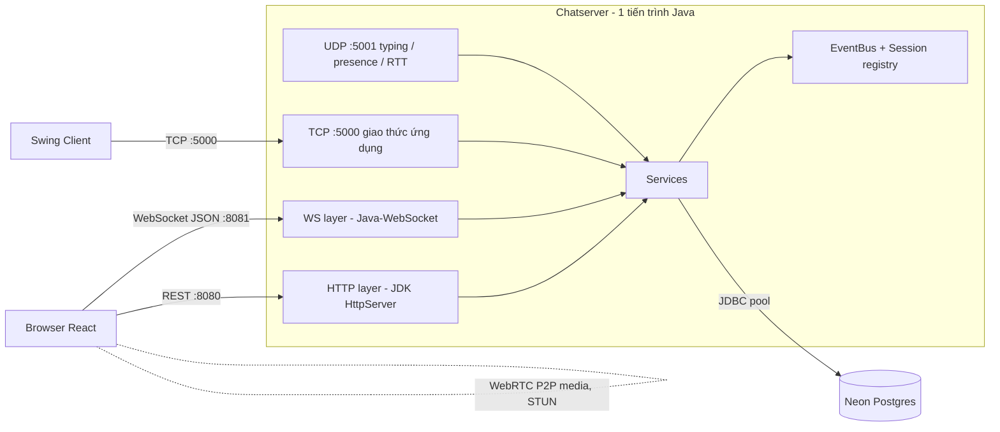
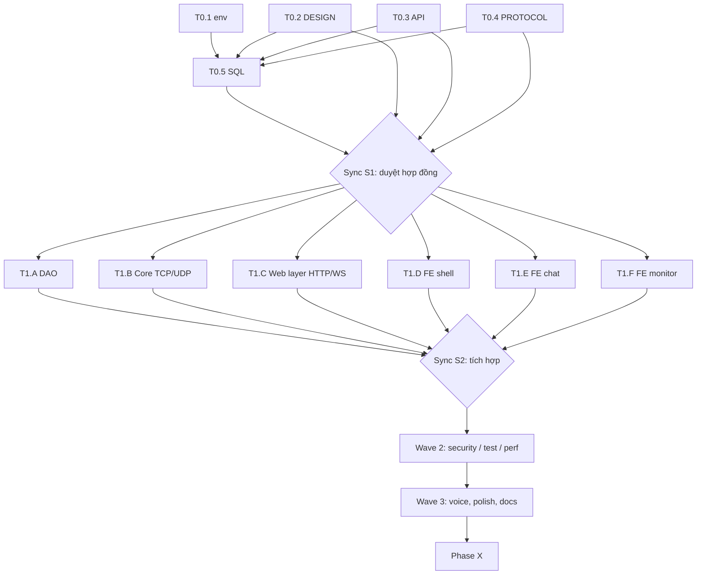

# Discord Web Clone — Kế hoạch triển khai

> Folder đích: `Uri/DA_LapTrinhMangMayTinh` · Branch: `feature/discord-web-clone` (repo có protected branch → làm qua PR, Conventional Commits).
> Trạng thái: **PLAN — chưa có code.** Chờ bạn duyệt để chạy `/create` hoặc `/orchestrate`.

## 1. Overview

Nâng cấp "Discord Mini" (Java TCP + Swing) thành **web app giống Discord**, vẫn giữ đúng tinh thần đề bài môn Lập trình mạng: *mô phỏng giao thức tầng vận chuyển (TCP, UDP) và tầng ứng dụng (giao thức tự thiết kế) bằng Java*.

**Project Type:** WEB (FE) + BACKEND (Java). Không phải mobile.

### Quyết định đã chốt (từ grill-me)

| # | Quyết định |
|---|---|
| 1 | **Nâng cấp tại chỗ**: giữ `Chatserver` (TCP :5000), viết lại `frontend`. Swing client giữ lại làm client phụ. |
| 2 | **Backend Java thuần, không Spring**: gộp lớp web vào chính `Chatserver` (1 tiến trình). REST = JDK `com.sun.net.httpserver.HttpServer`; WebSocket = thư viện `Java-WebSocket`; JSON = `Gson`; JWT tự viết bằng `javax.crypto`. Stretch: tự viết WebSocket RFC 6455 thay `Java-WebSocket`. |
| 3 | Tính năng: **tất cả** các mục (guild/channel/role, DM+bạn bè+presence, tin nhắn nâng cao, file/ảnh, WebRTC voice/video, Network Monitor, search/pin). Bot/slash command để backlog. |
| 4 | File/ảnh lưu **thẳng vào Neon (`bytea`)**, giới hạn 5 MB/file. |
| 5 | **Có kênh UDP** (typing/presence/RTT probe) song song TCP. |
| 6 | Font **Quicksand**, **dark/light mode**, DB **Neon**, `.env.example` để bạn tự điền key. |

## 2. Brainstorm — các hướng kiến trúc đã cân nhắc

| | A. Gateway Spring Boot ↔ TCP | B. Gateway Java thuần riêng ↔ TCP | **C. Gộp vào Chatserver, Java thuần (CHỌN)** |
|---|---|---|---|
| Mô tả | Browser ⇄ Spring ⇄ TCP ⇄ Chatserver | Như A nhưng viết bằng HttpServer | Chatserver mở thêm HTTP/WS/UDP listener, gọi thẳng service |
| ✅ | Framework đầy đủ | Tách biệt rõ | 1 tiến trình, 1 nơi chạm DB, tái dùng ClientHandler/RoomManager/ACK, hợp NetBeans/Ant |
| ❌ | Không dùng Spring (bạn loại), thêm 1 hop, 2 nơi chạm DB | Thêm 1 hop + 2 nơi chạm DB | Phải tách interface `Session` + `EventBus` cho sạch |
| Effort | Medium-High | Medium-High | Medium |

**Thư viện HTTP/WS (Java thuần):** A′ = `HttpServer` + `Java-WebSocket` + `Gson` ✅ (chọn) · B′ = Javalin (nhiều jar hơn) · C′ = tự viết WebSocket RFC 6455 (điểm cộng môn học, làm ở Wave 3 nếu còn thời gian).

**Chọn C + A′** vì hợp đề bài (TCP + UDP + HTTP/WS + giao thức ứng dụng tự thiết kế) và đơn giản nhất để vận hành.

**Lưu ý kỹ thuật Java thuần:** `HttpServer` không có router/multipart → tự viết router nhỏ (~80 dòng); upload gửi **raw body** (`PUT /api/files`, tên file + MIME trong header). Chạy handler trên virtual thread (Java 21).

### Ý tưởng bổ sung để app hoàn thiện (đã chọn ở mức nào)

| Ý tưởng | Mức |
|---|---|
| Guild → Channel, vai trò Owner/Admin/Member, invite link có hạn dùng | MVP+ |
| DM, bạn bè, presence 4 trạng thái, typing indicator (UDP) | MVP+ |
| Reply, edit/xoá, reaction, @mention, markdown (sanitize), unread badge, pin, search, phân trang cursor | MVP+ |
| Upload ảnh/file + preview, kéo-thả, dán ảnh | MVP+ |
| **Network Monitor**: RTT TCP vs UDP, biểu đồ, packet/frame log trực quan | MVP+ (điểm cộng môn học) |
| Voice/video 1-1 và nhóm nhỏ (WebRTC mesh ≤ 4 người, signaling qua WebSocket) | Wave 3 (stretch-in-scope) |
| Command palette `Ctrl+K`, phím tắt, toast, skeleton loading, empty state, i18n VI/EN | Polish |
| Bot `/roll` `/poll`, desktop notification, thông báo âm thanh | **Backlog** |

## 3. Kiến trúc



**Phân lớp (tránh logic trùng):**
- **Services** (`AuthService`, `GuildService`, `ChatService`, …) là nguồn sự thật duy nhất; TCP, WS và HTTP chỉ là *adapter* gọi service.
- **`Session` interface** có 2 impl: `TcpSession` (Swing) và `WsSession` (web); UDP dùng chung `userId`. **`EventBus`** phát sự kiện tới mọi session nên web và Swing chat chung phòng.
- **HTTP** lo auth (`/api/auth/*` → JWT), đọc lịch sử/search/members, **upload/serve file** (file không đi qua frame TCP vì giới hạn 65 536 ký tự).
- **Luồng đính kèm:** `PUT /api/files` → `bytea` → trả `attachmentId` → client gửi `SEND_MESSAGE` kèm `attachmentIds` qua WS.
- **Auth:** JWT HS256 tự viết (`javax.crypto`), dùng cho WS handshake (`?token=`) và lệnh TCP `AUTH_TOKEN|<jwt>`; Swing client vẫn `LOGIN` cũ.

## 4. Tech Stack

| Lớp | Công nghệ | Lý do |
|---|---|---|
| FE | React 19 + Vite + TypeScript (đã có), React Router, Zustand, TanStack Query, `react-virtuoso`, `react-markdown` + `rehype-sanitize`, Zod, `lucide-react`, `@fontsource/quicksand` | Tận dụng `frontend/` hiện có; virtual list cho chat dài; font self-host chạy offline |
| Styling | **Vanilla CSS + CSS variables** (tokens từ `DESIGN.md`) | Theo chuẩn dự án; đổi theme bằng `data-theme` |
| Web layer | JDK `HttpServer` (REST/upload), `Java-WebSocket`, `Gson` — jar tải bằng script `Chatserver/lib/download_*.ps1/.bat`, **không commit jar** | Java thuần, Ant/NetBeans, ít phụ thuộc |
| Core | Java 21 thuần (Ant/NetBeans như hiện tại), `ServerSocket`, `DatagramSocket`, JWT HS256 bằng `javax.crypto` | Đúng đề bài |
| DB | Neon Postgres (dùng **pooled endpoint**), migration SQL đánh số | pool tối đa 5–8 kết nối (giới hạn kết nối Neon) |
| Test | JUnit 5, Vitest, Playwright | Pyramid unit → integration → E2E |

## 5. Cấu trúc thư mục (mục tiêu)

```
DA_LapTrinhMangMayTinh/
├── DESIGN.md                  # design tokens (Wave 0)
├── .env.example               # biến môi trường mẫu (Wave 0)
├── discord-web-clone.md       # file này
├── docs/  PROTOCOL.md (v2) · API.md (REST+WS) · ARCHITECTURE.md
├── Chatserver/src/com/discordmini/server/
│   ├── network/ (TCP, cũ)   ├── udp/ (MỚI)   ├── session/ (Session, EventBus - MỚI)
│   ├── auth/ (JWT - MỚI)     ├── service/ dao/ model/ (mở rộng)
│   └── web/ (MỚI)  http/ · ws/ · files/ · search/
│   (+ sql/V003+)
├── ChatClient/                # Swing, giữ nguyên
├── frontend/src/{app,design,shared,features/{auth,guild,chat,dm,friends,files,monitor,voice,settings}}
└── scripts/  dev-all.ps1 · migrate.ps1
```

### `.env.example` (sẽ tạo, bạn tự điền key)

```
# --- Neon ---
NEON_JDBC_URL=jdbc:postgresql://<ep-xxx-pooler>.neon.tech/<db>?sslmode=require
NEON_DB_USER=
NEON_DB_PASSWORD=
# --- Security ---
JWT_SECRET=            # >= 32 ký tự ngẫu nhiên
JWT_TTL_MINUTES=60
# --- Ports ---
TCP_PORT=5000
UDP_PORT=5001
HTTP_PORT=8080          # REST + upload
WS_PORT=8081            # WebSocket
CORS_ORIGIN=http://localhost:5173
# --- Limits ---
MAX_UPLOAD_MB=5
MESSAGE_MAX_CHARS=4000
# --- WebRTC ---
STUN_URL=stun:stun.l.google.com:19302
TURN_URL=
TURN_USER=
TURN_PASSWORD=
```
Kèm `frontend/.env.example` (`VITE_API_URL`, `VITE_WS_URL`) và cập nhật `Chatserver/db.properties.example` đọc từ env.

## 6. Design (tóm tắt — chi tiết ở `DESIGN.md`)

- **Quicksand** 400/500/600/700 (hỗ trợ tiếng Việt). Code block dùng font mono hệ thống.
- **Dark là mặc định**, light qua `data-theme="light"`, nhớ lựa chọn + theo `prefers-color-scheme`.
- Bố cục 4 cột kiểu Discord: *Guild rail → Channel list → Chat → Member list*; mobile thu gọn thành drawer.
- Glass nhẹ, bo góc 12–16px, micro-animation (hover, gửi tin, reaction pop, toast).
- ⚠️ **Purple Ban của AG Kit**: tránh "blurple". Đề xuất accent **teal–emerald** (`#14B8A6` → `#10B981`) + điểm nhấn coral cho mention/badge. *Xem câu hỏi mở #1.*

## 7. Task Breakdown — chia cho sub-agent chạy song song

**Nguyên tắc song song:** chốt *hợp đồng* (Wave 0) rồi mỗi agent **sở hữu thư mục riêng**, không sửa file của nhau. FE làm việc trên `mock adapter` theo `docs/API.md`, không chờ BE.

### Wave 0 — Contract Freeze (tuần tự, ngắn; làm trước)

| ID | Task | Agent / Skill | Deps | INPUT → OUTPUT → VERIFY |
|---|---|---|---|---|
| T0.1 | Tạo branch, `.env.example` ×3, `.gitignore` chặn `.env`, `*.jar`; script tải `Java-WebSocket` + `Gson` + JDBC driver | `devops-engineer` · deployment-procedures | – | repo hiện tại → file mẫu → `git status` không có `.env` thật |
| T0.2 | `DESIGN.md` (tokens dark/light, Quicksand, components) | `frontend-specialist` · design-spec + frontend-design | – | brief §6 → `DESIGN.md` hợp lệ → `npx @google/design.md lint` pass |
| T0.3 | `docs/API.md`: REST endpoint + **WS event envelope** `{type, rid, payload}` + TypeScript types | `backend-specialist` · api-patterns | – | tính năng §2 → spec đầy đủ → mọi tính năng MVP+ có ≥1 endpoint/event |
| T0.4 | `docs/PROTOCOL.md` v2: lệnh mới (`AUTH_TOKEN`, guild/channel/role, `EDIT_MSG`, `DELETE_MSG`, `REACT`, `PIN`, `MARK_READ`, `SIGNAL_*`) + **UDP datagram format** + **chữ ký interface `Session`, `EventBus`, các `Service`** (dùng chung cho TCP/WS/HTTP) | `backend-specialist` · architecture | – | PROTOCOL v1 → v2 tương thích ngược → có bảng lỗi mới, giới hạn frame |
| T0.5 | `sql/V003__guilds_channels.sql` (xem §8) | `database-architect` · database-design | T0.4 | schema.sql → migration idempotent → chạy 2 lần trên Neon không lỗi |

🔒 **Sync S1:** bạn duyệt 5 file hợp đồng này rồi mới chạy Wave 1.

### Wave 1 — Build (6 agent chạy song song)

| ID | Agent (thư mục sở hữu) | Task | Skills | Verify |
|---|---|---|---|---|
| T1.A | `database-architect` (`Chatserver/sql`, `Chatserver/.../dao`) | DAO mới: Guild, Channel, Role, Reaction, Attachment, ReadState; chỉ mục cho phân trang cursor + `tsvector` search; migrate dữ liệu `rooms` cũ → guild "Legacy" | database-design | `scripts/migrate.ps1` OK; EXPLAIN dùng index |
| T1.B | `backend-specialist` #1 (`Chatserver/.../{network,service,protocol,udp,session,auth}`) | Tách `Session` + `EventBus` (refactor `ClientManager`), `TcpSession`; lệnh TCP mới theo PROTOCOL v2; **JWT** (`auth/`); phân quyền role trong `service/`; **UDP server** (`DatagramSocket`) cho typing/presence/RTT; ACK + request-id giữ nguyên | architecture, clean-code, systematic-debugging | JUnit protocol + 2 client giả lập |
| T1.C | `backend-specialist` #2 (`Chatserver/.../web/`) | `HttpServer` + router tự viết: `/api/auth/*` (JWT), history/search/members, **upload/serve file** (raw body), CORS; `WsSession` (Java-WebSocket) gọi thẳng Service, backpressure, ping/pong; map JSON envelope ↔ Service call (không qua TCP) | api-patterns, architecture, clean-code | `curl` login → JWT; `wscat` gửi tin, Swing client nhận được |
| T1.D | `frontend-specialist` #1 (`frontend/src/{app,design,shared,features/auth,settings}`) | Vite app shell, `tokens.css`, **Quicksand + theme toggle**, router, layout 4 cột, trang login/register, API client + WS client + mock adapter, i18n khung | frontend-design, frontend-architecture, design-spec | Mở app, đổi dark/light, F5 giữ theme |
| T1.E | `frontend-specialist` #2 (`features/{guild,chat,dm,friends,files}`) | Guild rail, channel list, message list (virtuoso), composer, reply/edit/xoá/reaction/mention/markdown/pin/search, unread badge, upload + preview, bạn bè/DM, typing indicator | frontend-design, nextjs-react-expert (perf) | Chạy với mock: gửi/sửa/xoá/react đủ luồng |
| T1.F | `frontend-specialist` #3 (`features/{monitor,voice}`) | **Network Monitor** (RTT TCP vs UDP, chart, frame log, trạng thái reconnect); khung WebRTC (call UI, signaling client) | performance-profiling, frontend-design | Monitor hiển thị dữ liệu mock real-time |

🔒 **Sync S2 (Integration):** thay mock adapter bằng API thật; chạy smoke: 2 trình duyệt chat qua WS → Service → Neon, có thêm 1 Swing client chat chung phòng.

### Wave 2 — Hardening (song song)

| ID | Agent | Task | Verify |
|---|---|---|---|
| T2.1 | `security-auditor` · vulnerability-scanner | Soát JWT, **PasswordUtil** (kiểm tra thuật toán băm hiện tại, nâng lên PBKDF2/BCrypt nếu yếu), rate-limit login/WS, sanitize markdown (XSS), chặn MIME/kích thước upload, CORS | `security_scan.py` không critical |
| T2.2 | `test-engineer` · testing-patterns, webapp-testing | JUnit (protocol, concurrency 50 client, disconnect cleanup), Vitest (store, parser), Playwright E2E (đăng ký → tạo guild → chat → react → upload → đổi theme) | tất cả pass thật, có báo cáo |
| T2.3 | `performance-optimizer` · performance-profiling | Neon cold-start (retry + keep-alive), cursor pagination, bundle split, virtual list 10k tin | Lighthouse ≥ 90 perf, TTFB API < 200 ms (warm) |

### Wave 3 — Voice/Video & Polish

| ID | Agent | Task | Verify |
|---|---|---|---|
| T3.1 | `backend-specialist` + `frontend-specialist` #3 | WebRTC signaling (`SIGNAL_OFFER/ANSWER/ICE`) qua WS (Service → EventBus → peer); mesh ≤ 4 người; mute/camera/leave; STUN/TURN từ env | 2 tab gọi được nhau, có audio/video |
| T3.2 | `frontend-specialist` #1 | Command palette, phím tắt, skeleton/empty state, toast, a11y (focus ring, aria, contrast AA), responsive mobile | `ux_audit.py` + contrast check pass |
| T3.3 | `devops-engineer` + `documentation` | `scripts/dev-all.ps1` (chạy Chatserver + FE một lệnh), README, `docs/ARCHITECTURE.md`, cập nhật bảng đóng góp | Người mới clone → chạy được trong < 10 phút |
| T3.4 *(tùy chọn, điểm cộng)* | `backend-specialist` | Tự viết WebSocket RFC 6455 (HTTP Upgrade, `Sec-WebSocket-Accept` = SHA-1 + Base64, parse/mask frame, ping/pong/close) thay `Java-WebSocket` | Test handshake + frame; web client chạy y như cũ, bỏ jar WS |

### Đồ thị phụ thuộc



**Critical path:** T0.4 → T1.B (`Session`/`EventBus`) → T1.C → S2 → T3.1. T1.C phụ thuộc *chữ ký* interface (đã chốt ở T0.4), không phụ thuộc code T1.B, nên vẫn chạy song song — dùng stub Service cho đến S2.
**Quy tắc xung đột:** cùng file → tuần tự; khác thư mục → song song. Thay đổi hợp đồng sau S1 phải cập nhật `docs/*` *trước* khi code.

## 8. Data model V003 (phác thảo, không code)

`guilds`, `channels(guild_id, type text|voice, position)`, `guild_members(role)`, `invites(code, expires_at, max_uses)`, `messages` **mở rộng**: `channel_id`, `reply_to`, `edited_at`, `deleted_at`, `pinned`, `search_vector`; `reactions(message_id, user_id, emoji)`, `attachments(id, message_id, filename, mime, size, data BYTEA)`, `read_states(user_id, channel_id, last_read_message_id)`, `dm_channels`. Bảng `friends` & `users` giữ nguyên; thêm `users.status`, `avatar_color`.

## 9. Rủi ro & ứng phó

| Rủi ro | Ứng phó |
|---|---|
| Neon tự suspend → request đầu chậm | Dùng pooled endpoint, retry có backoff, health ping |
| Neon free ~0.5 GB, `bytea` ăn nhanh | Giới hạn 5 MB, chỉ ảnh/pdf/zip, cảnh báo dung lượng; `StorageService` interface để đổi S3/R2 sau |
| Frame TCP 65 536 ký tự + Base64 | Tin nhắn ≤ 4000 ký tự; file không đi qua TCP |
| T1.B và T1.C cùng sửa 1 project Java | Phân package sở hữu (`network/udp/session/auth` vs `web/`); đồng bộ qua interface ở T0.4; PR nhỏ, merge thường xuyên |
| `Java-WebSocket` là thư viện ngoài | Giới hạn 2–3 jar tải bằng script; có kế hoạch tự viết WS (RFC 6455) ở Wave 3 |
| Lệch contract giữa agent song song | Wave 0 + Sync S1/S2, FE dùng mock theo `API.md` |
| WebRTC sau NAT cần TURN | STUN mặc định; TURN tùy chọn qua env; mesh ≤ 4 |
| UDP bị firewall chặn | Fallback: typing/presence qua TCP, Monitor báo "UDP blocked" |

## 10. Success Criteria

- [ ] 2+ trình duyệt chat realtime qua **WS → Service → Neon**, có lịch sử sau F5.
- [ ] Đủ tính năng đã chọn; dark/light + Quicksand đúng `DESIGN.md`.
- [ ] Network Monitor hiện RTT **TCP và UDP** riêng biệt + frame log.
- [ ] Swing client cũ vẫn chat được với web client (tương thích ngược PROTOCOL).
- [ ] Không có secret trong git; `.env.example` đầy đủ.

## Phase X — Final Verification (chạy thật mới được tick)

- [ ] `cd frontend && npm run lint && npx tsc -b && npm run build`
- [ ] Build Chatserver bằng `ant -f Chatserver clean jar` · JUnit/`main` test Chatserver pass
- [ ] `python .agents/skills/vulnerability-scanner/scripts/security_scan.py .`
- [ ] `python .agents/skills/frontend-design/scripts/ux_audit.py .`
- [ ] `python .agents/skills/performance-profiling/scripts/lighthouse_audit.py http://localhost:5173`
- [ ] `python .agents/skills/webapp-testing/scripts/playwright_runner.py http://localhost:5173 --screenshot`
- [ ] Thủ công: 2 tab chat · đổi theme · upload ảnh · reaction · tắt UDP xem fallback · gọi voice 2 tab
- [ ] Rule check: không purple hex · không template layout · Socratic Gate đã tôn trọng

## ✅ Quyết định bổ sung đã chốt (Socratic Gate)

1. **Màu chủ đạo & Theme mặc định:** **Xanh dương + Trắng** (`#2563EB` / `#0284C7` + `#FFFFFF` / `#F8FAFC`). **Light Mode là mặc định** khi mở web, có nút chuyển sang **Dark Navy** (`#0F172A` / `#0B1120`). Tuyệt đối không dùng mã màu tím (Purple Ban).
2. **Mapping dữ liệu (Guild/Channel ↔ Room):** **Gộp chung (`channel_id = room_id`)** — mở rộng bảng `rooms` thêm `guild_id`, `channel_type` (`text`/`voice`), `position`, `topic`. Web và Swing Client (`JOIN_ROOM|room_id`) chat chung 100% mọi kênh text mà không cần đồng bộ 2 bảng.
3. **Môi trường chạy & Cổng mạng:** Chạy **đa cổng chuẩn đề bài ở Local** (`TCP :5000`, `UDP :5001`, `HTTP :8080`, `WS :8081`) và hỗ trợ **Single-Port mode (`PORT` env)** cho Render:BE + Vercel:FE (tự động fallback UDP → WS/TCP khi lên cloud).
4. **Quy trình Git:** Tự động commit cho bạn sau mỗi milestone trên nhánh `feature/discord-web-clone`.

