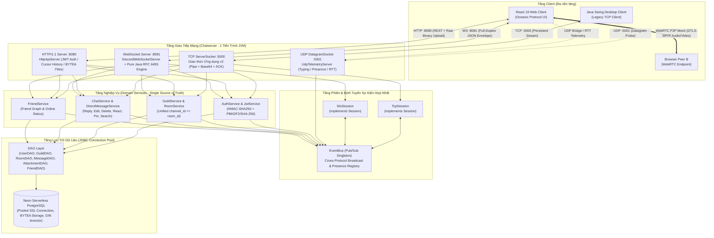
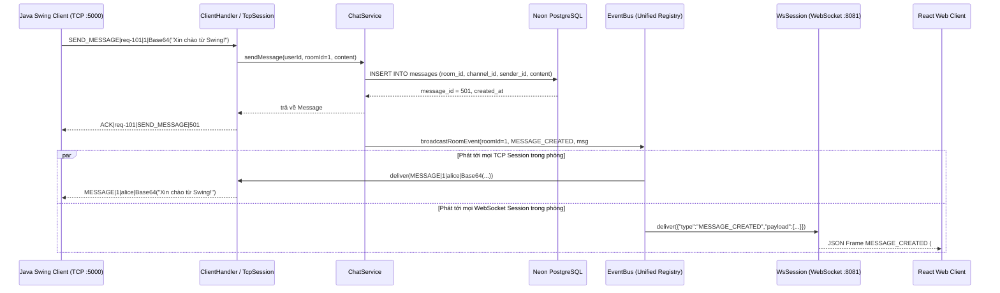
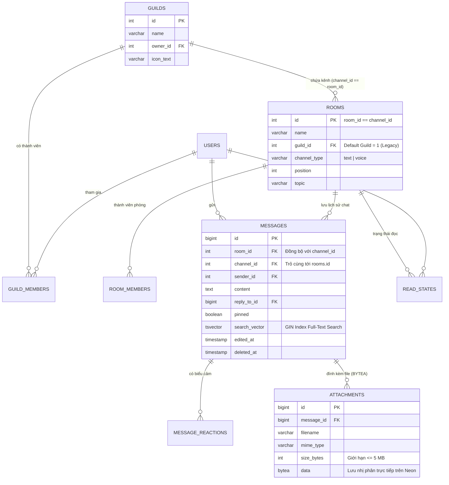

# Kiến Trúc Hệ Thống — Discord Web Clone (Oceanic Protocol Edition)

> Tài liệu đặc tả kiến trúc đa giao thức phục vụ bảo vệ Đồ án môn **Lập trình mạng máy tính (CMP180)**.
> Phiên bản: **2.0 (Multi-Protocol Unified Backend)** — Kết hợp liền mạch giữa **Java Swing Desktop Client** và **React 19 Web Application** trên một nhân máy chủ Java thuần duy nhất.

---

## 1. Tổng quan Kiến trúc Đa Giao Thức (Multi-Protocol Architecture)

Hệ thống **Discord Web Clone (Oceanic Protocol Edition)** nâng cấp kiến trúc Client–Server truyền thống thành một máy chủ hợp nhất đa giao thức chạy trong **một tiến trình JVM duy nhất (`com.discordmini.server.ServerApplication`)**.

Thay vì sử dụng các framework bậc cao che giấu tầng mạng (như Spring Boot), toàn bộ các giao thức ở **Tầng Vận Chuyển (Transport Layer — TCP, UDP)** và **Tầng Ứng Dụng (Application Layer — Custom Pipe/Base64 Protocol v2, HTTP/1.1 REST, WebSocket RFC 6455, WebRTC Signaling)** đều được cài đặt trực tiếp bằng Java thuần (`java.net.ServerSocket`, `java.net.DatagramSocket`, `com.sun.net.httpserver.HttpServer`, và RFC 6455 Frame Parser).

### Sơ đồ Kiến trúc Tổng thể

---

## 2. Phân tích Lý do Lựa chọn 5 Giao thức Mạng (CMP180 Defense Rationale)

Trong một hệ thống truyền thông thời gian thực hiện đại như Discord, **không một giao thức đơn lẻ nào tối ưu cho mọi tác vụ**. Dự án phối hợp 5 giao thức/cơ chế truyền thông, mỗi giao thức giải quyết đúng bài toán kỹ thuật của nó:

| Giao thức / Cổng | Lớp cài đặt chính | Vai trò trong hệ thống | Lý do lựa chọn (Trade-off Mạng máy tính) |
|---|---|---|---|
| **1. TCP Socket (`:5000`)** | `ChatServer`, `ClientHandler`, `ProtocolHandler` | Truyền nhận lệnh điều khiển và tin nhắn văn bản với `ChatClient` (Java Swing); hỗ trợ xác thực `LOGIN` truyền thống và `AUTH_TOKEN` (JWT). | **Độ tin cậy tuyệt đối & Thứ tự gói tin (Reliable, In-order Byte Stream):** Tin nhắn chat, thao tác tạo phòng, kết bạn không được phép mất gói hoặc đảo thứ tự. Cài đặt thêm tầng **Application ACK (`ACK\|reqId`)** và `RequestId` UUID để xác nhận xử lý nghiệp vụ đầu-cuối. |
| **2. UDP Datagram (`:5001`)** | `UdpTelemetryServer` | Gói tin báo trạng thái đang gõ phím (`TYPING`), cập nhật hiện diện (`PRESENCE`), và đo độ trễ mạng tức thời (`PING`/`PONG` RTT Probe). | **Độ trễ thấp, Không kết nối (Connectionless, Zero Head-of-Line Blocking):** Nếu 1 gói tin `TYPING` bị rơi trên đường truyền, gói tiếp theo sau 2 giây sẽ thay thế nó — việc bắt tay lại hay truyền lại (TCP Retransmission) là lãng phí băng thông và gây nghẽn dòng tin nhắn chính. Kèm cơ chế **Firewall Fallback** tự động chuyển qua WS/TCP nếu mạng chặn UDP. |
| **3. HTTP/1.1 REST (`:8080`)** | `HttpApiServer` (`JDK HttpServer`) | Đăng nhập/Đăng ký cấp phát JWT (`/api/auth/*`), phân trang lịch sử tin nhắn bằng con trỏ (`cursor pagination`), tìm kiếm toàn văn (`tsvector`), và tải lên/tải xuống tệp đính kèm nhị phân (`PUT /api/files`, `GET /api/files/:id`). | **Phi trạng thái (Stateless) & Truyền tải Nhị phân Lớn:** Frame TCP/WS văn bản bị giới hạn 65.536 ký tự và chịu chi phí phình kích thước ~33% nếu mã hóa Base64. Truyền file trực tiếp qua HTTP Raw Binary Stream (`application/octet-stream` -> PostgreSQL `bytea`, tối đa 5 MB) giúp tách biệt luồng tải tệp nặng khỏi luồng sự kiện thời gian thực. |
| **4. WebSocket (`:8081`)** | `DiscordWebSocketServer` & Pure Java `RFC 6455` Engine | Kênh đẩy sự kiện song công (Full-Duplex) cho trình duyệt Web: nhận tin nhắn tức thời, reaction, chỉnh sửa/xóa tin nhắn, trạng thái thành viên và truyền tín hiệu WebRTC (`SIGNAL_*`). | **Vượt rào cản Sandbox Trình duyệt:** Trình duyệt web không cho phép mở Raw TCP Socket tới `:5000`. WebSocket khởi đầu bằng bắt tay **HTTP/1.1 Upgrade (`101 Switching Protocols`)** với khóa `Sec-WebSocket-Accept` (SHA-1 + Base64), sau đó chuyển thành luồng khung nhị phân/văn bản có masking hai chiều với overhead cực nhỏ (2–14 bytes/frame). |
| **5. WebRTC P2P Mesh** | `VoiceService` (FE) + WS Signaling (`SIGNAL_OFFER/ANSWER/ICE`) | Cuộc gọi Thoại & Video nhóm nhỏ (tối đa 4 người/kênh thoại) trực tiếp giữa các trình duyệt qua STUN/TURN. | **Truyền thông Đa phương tiện Thời gian thực (DTLS-SRTP trên UDP):** Máy chủ Java chỉ làm nhiệm vụ **Signaling** (trao đổi SDP Offer/Answer và ICE Candidate qua WebSocket `:8081`). Luồng âm thanh/hình ảnh đi trực tiếp ngang hàng (Peer-to-Peer) giữa các trình duyệt để giảm tải băng thông máy chủ và đạt độ trễ âm thanh < 50 ms. |

---

## 3. Tầng Phiên Hợp Nhất (`Session` & `EventBus`) — Giao Tiếp Xuyên Giao Thức

Một thách thức lớn khi duy trì song song **Java Swing Client (TCP `:5000`)** và **React Web Client (WebSocket `:8081`)** là làm sao để hai thế hệ client khác giao thức có thể trò chuyện chung trong cùng một phòng theo thời gian thực mà không nhân đôi code nghiệp vụ.

### 3.1. Giao diện `Session` (`com.discordmini.server.session.Session`)

Mọi kết nối đang hoạt động sau khi xác thực đều được trừu tượng hóa qua giao diện `Session`:

- **`TcpSession`**: Bọc quanh `ClientHandler` (luồng TCP Socket). Khi nhận sự kiện từ `EventBus`, `TcpSession` chuyển đổi sự kiện thành chuỗi lệnh Pipe-delimited + Base64 (`MESSAGE|<roomId>|<sender>|<base64Content>|<timestamp>`) và đẩy xuống `Socket.getOutputStream()`.
- **`WsSession`**: Bọc quanh kết nối WebSocket của trình duyệt. Khi nhận cùng sự kiện đó từ `EventBus`, `WsSession` đóng gói thành JSON Envelope chuẩn (`{"type":"MESSAGE_CREATED","rid":null,"payload":{...}}`) và gửi qua khung WebSocket.

### 3.2. Bộ định tuyến `EventBus` (`com.discordmini.server.session.EventBus`)

`EventBus` đóng vai trò trung tâm điều phối (In-Memory Pub/Sub Broker):

1. Quản lý danh sách toàn bộ `Session` đang trực tuyến theo `userId` và `sessionId` (một người dùng có thể mở đồng thời cả ứng dụng Swing lẫn tab trình duyệt Web).
2. Quản lý tập hợp người dùng đang tham gia từng kênh/phòng (`roomId` / `channelId`).
3. Khi `ChatService.sendMessage(...)` lưu tin nhắn vào PostgreSQL thành công, nó phát sự kiện tới `EventBus.publishToRoom(roomId, ...)`.
4. `EventBus` tự động phân phối (fan-out) tới cả `TcpSession` lẫn `WsSession` trong phòng đó.

---

## 4. Mô Hình Dữ Liệu Hợp Nhất (`channel_id == room_id`)

Để đảm bảo **tương thích ngược 100%** với cơ sở dữ liệu và giao thức của ứng dụng Java Swing cũ, dự án áp dụng quyết định kiến trúc **Đồng nhất Kênh và Phòng (`channel_id == room_id`)** trong migration `Chatserver/sql/V003__guilds_channels.sql`:

### 4.1. Sơ đồ Quan hệ Thực thể (ERD)

### 4.2. Cơ chế Đồng bộ Tự động (Database Trigger & DAO)

1. **Guild Mặc định ("Legacy" / Server Chung):** Mọi phòng chat được tạo từ giao diện Java Swing cũ (`CREATE_ROOM`) tự động được gán vào Guild mặc định (`guild_id = 1`, `channel_type = 'text'`).
2. **Trigger Đồng bộ `room_id` ↔ `channel_id`:** Trong bảng `messages`, trigger SQL `trg_sync_message_room_channel` đảm bảo nếu câu lệnh INSERT chỉ truyền `room_id` (từ DAO cũ) thì `channel_id` tự động nhận giá trị của `room_id`, và ngược lại nếu Web Client truyền `channel_id` thì `room_id` tự động được điền.
3. **Lưu trữ Tệp Đính Kèm (`attachments.data BYTEA`):** Tệp ảnh/tài liệu tải lên qua `PUT /api/files` được kiểm tra kích thước (`<= 5 MB`) và MIME type an toàn trước khi lưu trực tiếp vào cột `BYTEA` trên Neon PostgreSQL, giúp hệ thống hoạt động độc lập không phụ thuộc dịch vụ lưu trữ đám mây bên thứ ba.

---

## 5. Cài Đặt Thuần Java Đáng Chú Ý (Điểm Nhấn Kỹ Thuật Môn CMP180)

### 5.1. Tự cài đặt Giao thức WebSocket RFC 6455 (`Rfc6455WebSocketServer`)
Bên cạnh adapter chuẩn, dự án cài đặt đầy đủ bộ giải mã khung WebSocket theo **RFC 6455** bằng `java.net.ServerSocket` thuần:
- **HTTP Upgrade Handshake:** Đọc header `Sec-WebSocket-Key`, nối với GUID chuẩn `258EAFA5-E914-47DA-95CA-C5AB0DC85B11`, băm `SHA-1` và mã hóa `Base64` để trả về `Sec-WebSocket-Accept`.
- **Frame Parsing & Unmasking:** Giải mã bit `FIN`, `Opcode` (`0x1` Text, `0x8` Close, `0x9` Ping, `0xA` Pong), độ dài tải tin mở rộng (7-bit, 16-bit unsigned, 64-bit) và phép toán XOR 4-byte `Masking-Key` cho dữ liệu từ trình duyệt gửi lên.

### 5.2. Đo Kiểm Mạng Thời Gian Thực (Network Monitor: TCP vs UDP RTT)
Module **Network Monitor** trên giao diện Web và `UdpTelemetryServer` ở Backend cho phép sinh viên và giảng viên quan sát trực quan sự khác biệt giữa hai giao thức tầng vận chuyển:
- **TCP RTT:** Đo thời gian khứ hồi của cặp gói tin `PING` → `PONG` trên kênh kết nối hướng luồng.
- **UDP RTT:** Đo thời gian khứ hồi của gói Datagram `PING|<seq>|<clientTs>` tới cổng `:5001`, hiển thị biểu đồ so sánh trực tiếp, tỷ lệ mất gói (Packet Loss / Jitter), và nhật ký khung tin (Live Packet/Frame Inspector).
- **Chế độ Single-Port & Firewall Fallback:** Khi chạy trên môi trường hạn chế cổng hoặc tường lửa chặn UDP, hệ thống tự động phát hiện timeout và chuyển sang chế độ **Fallback qua WebSocket/TCP** mà không làm gián đoạn trải nghiệm người dùng.

---

## 6. Hồ Sơ Quyết Định Kiến Trúc (Architecture Decision Records - ADR)

### ADR-001: Gộp Web Layer vào cùng tiến trình `Chatserver` bằng Java thuần
- **Bối cảnh:** Cần nâng cấp giao diện Web hiện đại cho đồ án Lập trình mạng mà vẫn giữ nguyên giá trị học thuật của máy chủ Socket Java.
- **Quyết định:** Khởi chạy `HttpApiServer` (`:8080`), `DiscordWebSocketServer` (`:8081`), và `UdpTelemetryServer` (`:5001`) ngay bên trong tiến trình `ChatServer` (`:5000`).
- **Hệ quả:** Không tốn độ trễ IPC giữa hai tiến trình; chia sẻ trực tiếp `EventBus` trong bộ nhớ và dùng chung JDBC Connection Pool (tối ưu giới hạn kết nối của Neon Serverless PostgreSQL).

### ADR-002: Xác thực Phi trạng thái bằng JWT HS256 Tự cài đặt (`javax.crypto`)
- **Bối cảnh:** Trình duyệt cần xác thực trên cả REST API (`Authorization: Bearer <jwt>`), WebSocket Handshake (`?token=<jwt>`), và lệnh TCP mới (`AUTH_TOKEN|<jwt>`).
- **Quyết định:** Tự cài đặt `JwtService` sử dụng `Mac.getInstance("HmacSHA256")` chuẩn của JDK, kết hợp băm mật khẩu `PBKDF2WithHmacSHA256` có salt ngẫu nhiên (tương thích ngược với tài khoản SHA-256 cũ).
- **Hệ quả:** Không cần thêm thư viện JWT nặng nề bên ngoài; minh bạch hoàn toàn cơ chế chữ ký số và xác thực thông điệp.
